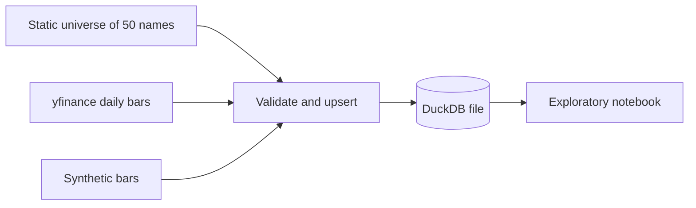

# Driftwood design decisions and interview guide

This is the document to study before talking about the project. It is written
alongside the code, milestone by milestone, and it describes what is actually
built. When a later milestone changes a decision, the old entry stays and a
new one says what replaced it.

## How to use this document

Read the architecture section out loud once. Then read each decision and
practice the interview answers without the document in front of you. The
answers are written in the first person so they can be said as-is, then
trimmed to the interviewer's patience.

## Architecture

Milestone 1 is the data stage only. Prices enter through one function, get
checked, and land in a local database. The notebook reads that database. It
does not compute signals.

A study is one DuckDB file. The default path is `data/driftwood.duckdb`
(`DRIFTWOOD_DB` overrides it). Rebuilding the file is always allowed; nothing
downstream is allowed to assume a hidden cache of unadjusted prices.

Two commands write the file:

- `driftwood ingest --start ... --end ...` calls yfinance.
- `driftwood ingest --synthetic` writes a deterministic random walk, with an
  optional 2-for-1 split, so the rest of the pipeline can be developed on a
  laptop with no network.

## Finance concepts in plain language

### OHLCV

A daily bar compresses a whole session into five numbers. Open is the first
print, high and low are the extremes, close is the last print, and volume is
how many shares changed hands. Driftwood does not store trades or quotes.
Anything we later say about "the price at 10:30" is a model built from this
bar, not a fact from the tape. That distinction matters as soon as execution
shows up.

### Adjusted close

Suppose a stock closes at $100 and splits 2-for-1 overnight. The next print
is about $50. A naive return of -50% is not a loss. The holder has twice as
many shares. Dividends do a smaller version of the same thing: the price
drops by roughly the dividend, and the holder is not poorer by that amount.

`adj_close` rewrites history so that percentage changes match the economic
return of a holder who reinvested dividends and rode through splits. Feature
math and model labels should use adjusted prices. The raw open, high, low,
and close stay in the table because they are what the exchange printed, and
because checking a suspicious return starts by comparing the two series.

The synthetic generator makes this concrete. One symbol is cut 2-for-1 at the
midpoint. Raw close and volume jump. `adj_close` does not. A test locks that
in: the raw return on the split day is worse than -40%, and the adjusted
return is an ordinary shock.

### Survivorship bias

If you take today's successful, liquid companies and download their history,
you have already selected winners. Companies that were delisted, acquired
under stress, or simply fell out of the large-cap list are missing. A
strategy tested only on survivors is graded on an easier exam than the one a
live book would have faced.

This project uses a fixed list of 50 names that are liquid right now. That is
a conscious shortcut for a portfolio project: the data is easy to explain,
the names are recognizable, and the downloads are reliable. It is not a
point-in-time S&P 500. Any performance number produced later has this bias
until a historical membership table is added. Say that before anyone asks.

### What "as of the close" will mean

No feature code exists yet. The storage choice is already shaped by the rule
we will enforce next: a decision stamped at the close of day `t` may use the
open, high, low, close, adjusted close, and volume of day `t`, and nothing
from day `t+1`. Both the raw and adjusted fields are known at that close
because the vendor publishes them with the daily bar. Putting the adjusted
close in the same row as the raw close does not, by itself, look into the
future. Using tomorrow's adjusted close as today's input would.

## Decision log

### ADR-001 — DuckDB as the research store

**Context.** The first cut is about 50 names, daily bars, and roughly 10
years: on the order of 100,000 rows. Later stages will join features and
predictions onto the same keys. The project has to install on Windows, Linux,
and macOS with no database server, and tests need a private database per run.

**Decision.** Store bars in one DuckDB file behind `MarketStore`. The bar
table has a primary key on `(symbol, date)`. A rerun is an
`INSERT ... ON CONFLICT DO UPDATE`, so a corrected download replaces the old
print instead of duplicating it. Coverage ("how many rows does AAPL have, and
what is the date range?") is a SQL query. Each ingest appends a row to
`ingest_runs` with a status and a JSON note of what was rejected.

**Alternatives.**

- Parquet or CSV only. Easy to inspect, awkward to upsert, and every coverage
  question becomes a pandas groupby. Parquet remains a reasonable export if a
  later stage wants a columnar snapshot outside the database.
- PostgreSQL. The right tool if several processes must write a shared
  production database. It is the wrong dependency for a single-researcher
  project and for CI.
- SQLite. Equally portable, and perfectly able to hold this table. Weaker
  once scans and window functions dominate, which is where this project is
  going. DuckDB returns a pandas frame in one call and is built for that scan.
- Keep the frame in memory and pickle it. There is then no durable record of
  what was downloaded, and the notebook cannot be reopened tomorrow.

**Tradeoff.** We take a dependency on DuckDB's SQL dialect, which is not
Postgres. Transactions and the `EXCLUDED` alias have to be tested rather than
assumed. In return there is no daemon, the file is gitignored, and a broken
download is fixed by deleting the file or by upserting over it.

**Why this one.** The data is an analytical table with a natural primary key,
used by one person. DuckDB matches that shape. The store API is small
(`upsert_bars`, `read_bars`, `coverage`, `read_runs`), so swapping the engine
later does not rewrite the research code.

### ADR-002 — Bar schema, and keeping both closes

**Context.** yfinance can return an auto-adjusted OHLC series and hide the
raw close, or it can return both. Downstream code will disagree about which
one it wants: return math wants the adjustment, a sanity check of a split
wants the raw print.

**Decision.** Every stored row has `symbol`, `date`, `open`, `high`, `low`,
`close`, `adj_close`, `volume`, `source`, and `ingested_at`. The downloader
calls yfinance with `auto_adjust=False` so `Adj Close` is a separate column.
If a future vendor frame omits that column, the normalizer copies `close`
into `adj_close` and warns, rather than inventing an adjustment factor. The
source string (`yfinance` or `synthetic`) and the ingest timestamp say where
a number came from.

The universe used for a run is written to `universe_members` (symbol, name,
sector). An unknown ticker is stored as sector `Unknown` instead of being
dropped, so an ad-hoc download is still described by the database.

**Alternatives.**

- Store only adjusted OHLC. Simpler joins later, but a bad adjustment becomes
  invisible.
- Store a corporate-action event table and adjust ourselves. More correct, and
  more than this milestone should own. yfinance's adjusted close is the event
  table, compressed into one column, with the vendor's known quirks.
- Store one row per field (long format). Flexible and painful to read.

**Tradeoff.** Two close columns means every later query must choose. The
column names are explicit so the choice is visible. We do not yet build
adjusted open, high, and low; a later execution stage will scale the raw
OHLC by `adj_close / close` when it needs a split-safe path.

**Why this one.** Disk is cheap next to the cost of being unable to explain a
return. The primary key makes "one session, one print" a constraint rather
than a convention.

### ADR-003 — A fixed list of 50 liquid names

**Context.** The brief asks for about 50 liquid S&P 500 stocks and about 10
years of daily bars. A point-in-time membership history is a data product of
its own (and many of the good ones are paid).

**Decision.** `driftwood/data/universe.py` holds 50 current large, liquid US
listings spread across sectors, with a display name and a GICS-style sector.
The sector is metadata for the notebook and for a later neutral portfolio. It
is not a model feature yet. The CLI defaults to this list and accepts
`--symbols` for a smaller pull.

**Alternatives.**

- The actual S&P 500 point-in-time. Right answer for a live research process,
  wrong first dependency.
- A handful of names such as SPY constituents' top 10. Faster, but too small
  to show a cross-sectional signal later.
- Pull whatever yfinance returns for `^GSPC` today and pretend it is history.
  That is survivorship bias with extra steps, and the index's current members
  are not all equally liquid.

**Tradeoff.** Interviews will ask about survivorship, and the honest answer
is "yes, the study has it." We would rather give that answer than hide the
list behind a download that looks more official than it is.

**Why this one.** The list is readable in one file, stable in tests, and
liquid enough that a later paper-trading stage is not fighting penny-stock
prints. `BRK-B` is left out on purpose: the hyphen is a needless source of
vendor-symbol bugs in a first version.

### ADR-004 — One network function, everything else pure

**Context.** Tests must not need a network or an API key. yfinance's frame
shape has changed across versions (flat columns for one ticker, a column
`MultiIndex` in either field-then-ticker or ticker-then-field order, and
sometimes no `Adj Close` when prices are pre-adjusted).

**Decision.** `fetch_yfinance_bars` is the only function that imports
yfinance. It forces `auto_adjust=False`, `group_by="column"`, `threads=False`,
and `progress=False`. `normalize_download` turns those layouts into one
long frame: `symbol, date, open, high, low, close, adj_close, volume`.
`ingest_frame` validates and writes. Tests replace `fetch_yfinance_bars` or
call `normalize_download` on a hand-built frame. A rectangular download pads
missing sessions with all-NaN prices; those padding rows are dropped before
validation so they are not reported as corrupt prints.

**Alternatives.**

- Mock HTTP. Brittle, because yfinance's URLs and cookies move, and it tests
  their client more than our code.
- Record a fixture of a real download and check it in. Honest, but large, and
  it goes stale the next time the column layout changes. The normalizer tests
  cover the layouts directly with a few rows.
- Call the network in CI and skip on failure. That is a flaky test with a
  permission slip.

**Tradeoff.** A bug inside yfinance itself will not be caught here. A bug in
how we ask yfinance for data will: the test asserts `auto_adjust is False`
and the date arguments. That is the bug that would silently change every
return in the project.

**Why this one.** The risky part of ingestion is the reshape and the decision
to adjust or not. Those are pure functions and they are where the tests sit.

### ADR-005 — Reject bad bars before they are stored

**Context.** A single inverted high/low or a zero price becomes an absurd
return and then a confident model coefficient. Downstream code should not
have to re-check the vendor.

**Decision.** `validate_bars` drops a row for the first reason that applies:
missing symbol or date, non-finite price, non-positive price, high/low that
cannot contain the open and close, or a volume that is missing, negative, or
not a whole share count. Duplicate `(symbol, date)` keys in one batch keep
the last row and count the others as `duplicate_in_batch`. The ingest result
and the `ingest_runs.notes` JSON both carry the counts. A run that writes
nothing is status `empty` and the CLI exits 1. A crash during the write is
status `error`, and the exception still propagates.

Symbols are passed to DuckDB as bound parameters. A ticker is never
interpolated into the SQL string.

**Alternatives.**

- Coerce and keep going (replace bad highs with the close, fill volume with
  zero). That hides data bugs inside the research.
- Fail the whole batch on the first bad row. Safer, but one bad name should
  not discard a 50-name download. Missing symbols are listed instead.

**Tradeoff.** Strict volume rules can reject a vendor row that used a
fractional share count. These names trade in whole shares at the daily-bar
level we care about, and a fractional volume is much more likely to be a
parse error. The threshold for "this float is an integer" is `1e-6`, so
`1000.0` is accepted.

**Why this one.** Garbage rows are cheap to drop and expensive to debug six
milestones later. The counts make the drop visible.

### ADR-006 — A synthetic book with a known split

**Context.** The notebook, the CLI, and every later test need bars when
yfinance is unreachable. The series also needs one feature a reviewer can
check by eye.

**Decision.** `synthetic_bars` draws a seeded geometric random walk on
business days, builds a high and low around the open and close, and, when
asked, applies a 2-for-1 split to one symbol at the midpoint. The raw OHLC
halves, volume doubles, and `adj_close` stays on the pre-split path. The same
seed returns the same frame. The default CLI path does not split; the
notebook and the `--split-symbol` flag opt in.

**Alternatives.**

- Check a small real CSV into the repo. Reproducible, but then the project
  ships market data and a license question, and the split is whatever the
  vendor did.
- Use random data with no split. Fine for smoke tests, useless for teaching
  adjustment.

**Tradeoff.** Nobody should quote a Sharpe ratio from this data. The
generator is named `synthetic` and the stored `source` column says so.
Random-walk prices have none of the cross-sectional structure a later model
will try to find; tests that need a known signal will construct that signal
on top, not expect the walk to contain it.

**Why this one.** It makes the adjusted-close story demonstrable in the
notebook and lockable in a test, with no network.

## Known limitations

- Survivorship bias, as above. No delistings, no historical index membership.
- Daily bars only. Nothing in the file can tell you the intraday path.
- Adjusted close is the vendor's number, not an event-level replay we control.
  yfinance has had adjustment bugs in the past. The raw close is the check.
- The synthetic split scales the whole post-split OHLC. It does not model an
  opening auction or a dividend.
- One writer, one file. There is no locking story for two ingests at once.
- `universe_members` is replaced on each ingest with the symbols requested
  that time. It is "who this file was last loaded for," not a history of
  membership.
- No feature, model, simulator, backtest, broker, or dashboard exists yet.

## What I would build next on this stage

A point-in-time membership table, even a hand-maintained one for the years
under study. A stored adjustment factor (`adj_close / close`) computed at
ingest so later code cannot divide by a zero close unnoticed. An export to
Parquet for anything that wants to leave DuckDB. None of that is required to
start feature work, as long as the survivorship limitation stays written down.

## Interview questions

### Walk me through the project

Two-minute version of what exists today. Later milestones extend this answer;
they do not get claimed yet.

"Driftwood is a US equity research pipeline I am building end to end, from
daily prices through paper trading. The first piece is the data layer,
because every result after it depends on those rows being the rows I think
they are.

I keep a fixed list of 50 liquid large caps. I download daily bars with
yfinance, with auto-adjust turned off, so I store the raw open, high, low,
close, and the adjusted close side by side. Adjusted close is what I will use
for returns, since splits and dividends would otherwise look like price
moves. The raw close is how I check the vendor. A synthetic generator writes
the same schema, including a 2-for-1 split, so I can develop without the
network.

Before anything hits disk I drop bars with missing dates, non-positive prices,
a high/low that cannot contain the open and close, or a nonsense volume.
Duplicates for the same symbol and day collapse to the last copy. The
survivors go into a local DuckDB file, keyed by symbol and date, so a rerun
overwrites instead of appending a second copy. Each run writes a log row with
how many rows were rejected and which symbols never arrived.

I chose DuckDB over Postgres because this is one researcher and one file, and
over a pile of CSVs because I want a primary key and a coverage query. The
limitation I will say out loud is survivorship: this is today's liquid names,
not the historical S&P 500, so any backtest I add later is optimistic until I
fix membership. Tests never call the network. They pass a frame that looks
like yfinance, and they check that the real call would have asked for
unadjusted prices."

### Why DuckDB instead of Parquet or Postgres?

"Parquet is a file format. I would still need to invent upserts, a run log,
and the coverage query. Postgres is what I would want if more than one
process had to share a production database. Here the whole dataset is about a
hundred thousand daily rows and one user, so an embedded analytical database
is the smaller system. DuckDB gives me SQL, a primary key, and a dataframe
back. The application code talks to a small store class, so the choice is not
smeared across the project."

### Why store the raw close and the adjusted close?

"They answer different questions. The adjusted close is the economic series:
a 2-for-1 split should not look like the stock fell in half. The raw close is
the print, and it is how I notice a bad adjustment. I force yfinance's
auto-adjust flag off so the vendor cannot collapse those into one column
without me seeing it. If the adjusted column is ever missing, I copy the raw
close and warn, rather than guessing a factor."

### Does this backtest have survivorship bias?

"The data stage already does, and I have not backtested yet. The universe is
50 names that are large and liquid now. Anything that was delisted or fell
out of the large-cap set over the last ten years is absent. I would not quote
a performance number from this list as if it were a tradable historical
S&P 500. The fix is a membership table with as-of dates, and I have not built
that."

### How do you test a downloader without hitting the network?

"The download is one function. Everything after it is a reshape, a validator,
and a database write. Tests call the reshape with the column layouts yfinance
has actually returned, and they replace the download function when they want
to exercise the CLI. One test checks the arguments we would have sent,
including auto-adjust off. I do not mock the HTTP layer, because that tests
yfinance's client rather than my invariant."

### What happens if ingestion runs twice?

"The bar primary key is symbol plus date. The second run updates those rows
in place, including the source and the ingest timestamp. The run log is
append-only, so I can see that a correction happened. Symbols that were
requested and produced no valid row are listed on the result; they are not
silently filled."
