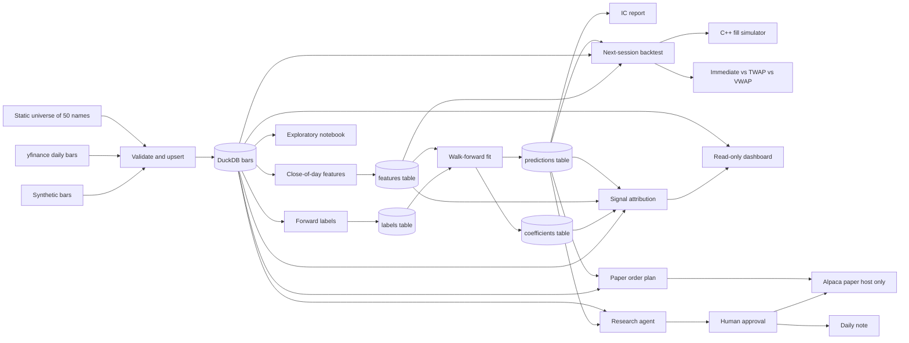

# Driftwood design decisions and interview guide

This is the document to study before talking about the project. It is written
alongside the code, milestone by milestone, and it describes what is actually
built. When a later milestone changes a decision, the old entry stays and a
new one says what replaced it.

## How to use this document

Read the architecture section out loud once. Then read each decision and
practice the interview answers without the document in front of you. The
answers are written in the first person so they can be said as-is, then
trimmed to the interviewer's patience.

## Architecture

Prices enter through one function, get checked, and land in a local database.
Features and labels are computed from that table and written back into the
same file, in two tables, so a query against `features` cannot see the
forward return.

The backtest reads the prediction column, the adjusted bar, and `vol_21`
from the signal date. It does not read the label. The simulator still
prices one order at a time. The three schedules do not share a fill.

The paper plan uses the same weights and the same signal close. It does
not call the simulator. A dry run never constructs a broker client.
`--submit` talks only to `https://paper-api.alpaca.markets`. The
dashboard reads the file and does not send orders. The research agent
stops before it acts. A person names the actions that may run, and a
paper order from that list still goes through the same host gate.

A study is one DuckDB file. The default path is `data/driftwood.duckdb`
(`DRIFTWOOD_DB` overrides it). Rebuilding the file is always allowed; nothing
downstream is allowed to assume a hidden cache of unadjusted prices.

Commands:

- `driftwood ingest --start ... --end ...` calls yfinance.
- `driftwood ingest --synthetic` writes a deterministic random walk, with an
  optional 2-for-1 split, so the rest of the pipeline can be developed on a
  laptop with no network.
- `driftwood features` rebuilds the feature and label tables from whatever
  bars are already stored.
- `driftwood train` reads those two tables, fits a fresh model on each
  training window, and writes out-of-sample predictions. `--report` writes
  the information-coefficient note beside the file. The predictions table
  keeps one row set per model name.
- `driftwood.execution.execute_order` prices one order by calling
  `driftwood._sim`. Installing the package builds that module. There is no
  separate compile command.
- `driftwood backtest` reads bars, predictions, and `vol_21`, and writes a
  comparison of the three schedules. It trades `prediction`. The label
  stored beside it is not an input.
- `driftwood train` also writes the fold coefficients. Retraining one
  model replaces that model's rows and leaves the others.
- `driftwood paper` prints the next-session share deltas. It does not
  send them unless `--submit` is set, and then only to the Alpaca paper
  host. A dry run does not need API keys.
- `driftwood attribute` splits the last scored close-to-close return
  across signals. The note says that sum is not the filled equity curve.
- `streamlit run dashboard/app.py` draws coverage and that attribution.
  The page has no order button.
- `driftwood agent` reads the study file, asks the chat model for a JSON
  list of proposals, and stops before any action. `--approve` is the only
  way an action runs. The model cannot set that list.

## Finance concepts in plain language

### OHLCV

A daily bar compresses a whole session into five numbers. Open is the first
print, high and low are the extremes, close is the last print, and volume is
how many shares changed hands. Driftwood does not store trades or quotes.
Anything we later say about "the price at 10:30" is a model built from this
bar, not a fact from the tape. That distinction matters as soon as execution
shows up.

### Adjusted close

Suppose a stock closes at $100 and splits 2-for-1 overnight. The next print
is about $50. A naive return of -50% is not a loss. The holder has twice as
many shares. Dividends do a smaller version of the same thing: the price
drops by roughly the dividend, and the holder is not poorer by that amount.

`adj_close` rewrites history so that percentage changes match the economic
return of a holder who reinvested dividends and rode through splits. Feature
math and model labels should use adjusted prices. The raw open, high, low,
and close stay in the table because they are what the exchange printed, and
because checking a suspicious return starts by comparing the two series.

The synthetic generator makes this concrete. One symbol is cut 2-for-1 at the
midpoint. Raw close and volume jump. `adj_close` does not. A test locks that
in: the raw return on the split day is worse than -40%, and the adjusted
return is an ordinary shock.

### Survivorship bias

If you take today's successful, liquid companies and download their history,
you have already selected winners. Companies that were delisted, acquired
under stress, or simply fell out of the large-cap list are missing. A
strategy tested only on survivors is graded on an easier exam than the one a
live book would have faced.

This project uses a fixed list of 50 names that are liquid right now. That is
a conscious shortcut for a portfolio project: the data is easy to explain,
the names are recognizable, and the downloads are reliable. It is not a
point-in-time S&P 500. Any performance number produced later has this bias
until a historical membership table is added. Say that before anyone asks.

### Lookahead bias

Lookahead bias is using information that was not available at the time of the
decision and then treating the result as if you could have traded it. The
classic version in this kind of project is a feature on Monday that quietly
includes Tuesday's close. The backtest looks brilliant. The live book cannot
see Tuesday.

Driftwood's rule is stamped at the **close** of session `t`. A feature on
that row may use the open, high, low, close, adjusted close, and volume of
session `t`, and any earlier session. It may not use session `t+1`. The same
day's high and low are allowed, because the decision is after the close, when
those prints have happened. They would not be allowed for a decision at the
open. That distinction is the whole argument, and it is written down as
`SIGNAL_TIME = "close"` next to the feature code.

The forward return is not a feature. `fwd_ret_1d` on day `t` is the adjusted
return from that close to the next stored close. It is the thing we would
like to predict. It lives in `labels.py` and in a separate database table.

Two operations that feel innocent and are not:

- A centered rolling mean. The value dated Monday uses days on both sides of
  Monday.
- A z-score, or any scaler, fit on the whole sample. The 2018 value then
  depends on the dispersion of 2024.

The check is truncation, and it is a test rather than a comment. Build the
features on the full panel. Build them again using only rows on or before a
cutoff. Every feature value on or before that cutoff has to match. The test
also runs the same check on a negative shift, a centered window, and a
full-sample z-score, and those three are required to fail. If someone
"simplifies" the test later, the negative cases still have to go red.

### Walk-forward validation

A model that is fit on a random mix of dates will train on days that, in
life, had not happened yet. Walk-forward refuses that. Time is cut into
successive test windows. The default test is 63 sessions, about a quarter.
The fit for a window uses only sessions before it, and not even all of
those: a purge is left in between.

The purge is the embargo, and it is at least the label horizon. `fwd_ret_1d`
on the day before the test is the return from that close to the first test
close. If that row is in the training set, the model has already seen part
of the test outcome. Five purged sessions is the default, which also covers
`fwd_ret_5d`.

The training window expands by default. After a test quarter has happened,
the next fold may train on it. That is not leakage. Those returns are in the
past relative to the new test window. `--rolling` keeps a fixed length when
the older regime should fall out of the fit.

What gets stored is the out-of-sample forecast. How well the model fit its
own training window is reduced to one number, the in-sample mean IC, so
those rows cannot be traded by accident later.

### Information coefficient

The information coefficient on a day is the correlation, across the names in
the book, between the forecast and the realized forward return. Spearman
correlation uses ranks. That is the headline, because a cross-sectional book
makes or loses money by ordering names, not by the units of the forecast.
The mean IC averages the daily number. A positive mean means the order was
right more often than wrong.

It is not a portfolio return. It does not know about position size, shorts,
or costs. A Sharpe ratio is a later question.

Two numbers that sit next to the IC and are not the IC:

- Pearson correlation, which keeps magnitude instead of rank.
- A pooled regression of every realized return on every forecast. The slope
  is a hedge ratio. A day when every forecast is identical has no rank to
  score, so the IC for that day is missing, even if a pooled slope could
  still be estimated from other days.

The t-stat that divides the mean IC by its standard error treats days as
independent. Overlapping labels break that. A five-day return shares four
days with the next one, so the plain t-stat is too flattering. The report
also prints a Newey-West (HAC) t-stat with lags equal to the horizon. That
is the number to quote when the label is longer than one day. It is still a
diagnostic, not a promise.

### TWAP, VWAP, and the path inside a daily bar

A daily bar does not say what happened at 10:30. Any sentence about an
intraday fill is a model. Driftwood's model has three pieces, and they are
deliberately simple enough to test.

The path. An up day, where the close is at least the open, prints in the
order open, low, high, close. A down day prints open, high, low, close.
Those four prices are anchors at the start, one third, two thirds, and the
end of the session. Between them the price is a straight line. Bin `i` of
`n` (eight bins by default) is the price at the middle of that slice, at
time `(i + 0.5) / n`. Every anchor is inside the high and the low, and a
straight line between inside points stays inside. The tests check that,
including a flat bar where every price is the same print.

The schedule. Immediate puts the whole order in the first bin and prices
that bin at the open, which is not the same number as the first path
midpoint. TWAP targets an equal number of shares in every bin. VWAP targets
shares in proportion to a U-shaped volume guess: the open and the close are
heavier than the middle, and the weights sum to one. That U is not this
stock's real volume curve. A daily bar cannot tell us that.

The cap. A bin will not fill more than `participation_limit` (default 10
percent) of that bin's volume. Shares that do not fit carry into the next
bin. Shares still left at the close are unfilled. An immediate order that
is small relative to the opening volume therefore prints at the open. A
large one starts at the open and then walks the path. Calling the second
case a pure market-on-open would be a lie, so the carry is part of the
definition.

### What a fill costs

The raw price is the path (or the open, for the first bin of an immediate
order). The fill price moves against the trader. A buy pays more. A sell
receives less. The fraction is half the spread, in basis points, plus
`impact_coef * sigma * sqrt(participation)`. Participation is the shares
filled in that bin divided by the bin's volume. Sigma is trailing
volatility the caller passes in. The simulator does not compute it, and it
does not own a calendar, so it cannot know whether the caller cheated and
passed a future number. That check belongs to the backtest.

Commission is dollars per filled share. It is subtracted in the cash
amount. It is not inside the fill price, so a test can see the spread
without confusing it with the ticket charge. Cash is from the trader's
side of the account: buying makes it negative. A round trip that buys and
sells the same schedule, with a positive half spread, loses money even
when the raw prices match. With the costs set to zero the same round trip
comes out flat. The impact term is a square-root shape in the spirit of
Almgren-Chriss. The coefficient is not calibrated to anything. It is there
so a larger slice of a bin costs more than a smaller slice, and so the
unit can be explained.

### The backtest clock

The decision and the fill are on different sessions. At the close of day
`t` the score is known, the adjusted close is known, and `vol_21` is known.
Target weights are built from that cross-section. Share counts are
`weight * equity / close`, using that same close, so the order does not
depend on tomorrow's open. The order is handed to the simulator with
tomorrow's adjusted bar. Tomorrow's sigma is not consulted.

The equity recorded on day `t` already includes the close of day `t`. The
new order cannot collect the move from day `t-1` to day `t`, because that
move was marked before the order existed. A test builds a bar whose open
is the old price and whose close has jumped, puts the score on that close,
and requires the equity not to jump. The fill shows up on the next session,
at the next session's price.

Dates with fewer than two scores do not generate a new target. The book
holds. An order that was already queued still fills. The last close in the
file generates orders that have no next session, and those orders are
dropped. There is no trade on a day that does not exist.

### Dollar-neutral weights, Sharpe, drawdown, turnover

Dollar-neutral here means the weights are built from the score minus that
day's average score, so the raw book is long the winners and short the
laggards in equal dollars. Gross exposure is the sum of absolute weights.
A cap then limits each name. The cap is applied once, and any room under
the cap is filled once, in proportion, on the side the name already had.
Names that were exactly zero stay zero. If the cap binds, the gross can
finish short of the target and the net can finish away from zero. A second
pass would either break the cap or quietly change the book. One pass keeps
both facts visible.

The Sharpe ratio in the report is the mean daily strategy return divided
by its sample standard deviation, multiplied by the square root of 252.
The risk-free rate is zero. A constant return has no standard deviation
and the Sharpe is reported as missing, not as infinity. Max drawdown is
the lowest value of equity divided by the running peak, minus one. A loss
is a negative number. Turnover is the raw notional traded that day divided
by the equity the order was sized on. Cost is what the fill charged beyond
the raw price, plus commission. A day when the market moved and the
schedule did not pay a spread can have a return and a cost of zero.

## Decision log

### ADR-001 — DuckDB as the research store

**Context.** The first cut is about 50 names, daily bars, and roughly 10
years: on the order of 100,000 rows. Later stages will join features and
predictions onto the same keys. The project has to install on Windows, Linux,
and macOS with no database server, and tests need a private database per run.

**Decision.** Store bars in one DuckDB file behind `MarketStore`. The bar
table has a primary key on `(symbol, date)`. A rerun is an
`INSERT ... ON CONFLICT DO UPDATE`, so a corrected download replaces the old
print instead of duplicating it. Coverage ("how many rows does AAPL have, and
what is the date range?") is a SQL query. Each ingest appends a row to
`ingest_runs` with a status and a JSON note of what was rejected.

**Alternatives.**

- Parquet or CSV only. Easy to inspect, awkward to upsert, and every coverage
  question becomes a pandas groupby. Parquet remains a reasonable export if a
  later stage wants a columnar snapshot outside the database.
- PostgreSQL. The right tool if several processes must write a shared
  production database. It is the wrong dependency for a single-researcher
  project and for CI.
- SQLite. Equally portable, and perfectly able to hold this table. Weaker
  once scans and window functions dominate, which is where this project is
  going. DuckDB returns a pandas frame in one call and is built for that scan.
- Keep the frame in memory and pickle it. There is then no durable record of
  what was downloaded, and the notebook cannot be reopened tomorrow.

**Tradeoff.** We take a dependency on DuckDB's SQL dialect, which is not
Postgres. Transactions and the `EXCLUDED` alias have to be tested rather than
assumed. In return there is no daemon, the file is gitignored, and a broken
download is fixed by deleting the file or by upserting over it.

**Why this one.** The data is an analytical table with a natural primary key,
used by one person. DuckDB matches that shape. The store API is small
(`upsert_bars`, `read_bars`, `coverage`, `read_runs`), so swapping the engine
later does not rewrite the research code.

### ADR-002 — Bar schema, and keeping both closes

**Context.** yfinance can return an auto-adjusted OHLC series and hide the
raw close, or it can return both. Downstream code will disagree about which
one it wants: return math wants the adjustment, a sanity check of a split
wants the raw print.

**Decision.** Every stored row has `symbol`, `date`, `open`, `high`, `low`,
`close`, `adj_close`, `volume`, `source`, and `ingested_at`. The downloader
calls yfinance with `auto_adjust=False` so `Adj Close` is a separate column.
If a future vendor frame omits that column, the normalizer copies `close`
into `adj_close` and warns, rather than inventing an adjustment factor. The
source string (`yfinance` or `synthetic`) and the ingest timestamp say where
a number came from.

The universe used for a run is written to `universe_members` (symbol, name,
sector). An unknown ticker is stored as sector `Unknown` instead of being
dropped, so an ad-hoc download is still described by the database.

**Alternatives.**

- Store only adjusted OHLC. Simpler joins later, but a bad adjustment becomes
  invisible.
- Store a corporate-action event table and adjust ourselves. More correct, and
  more than this milestone should own. yfinance's adjusted close is the event
  table, compressed into one column, with the vendor's known quirks.
- Store one row per field (long format). Flexible and painful to read.

**Tradeoff.** Two close columns means every later query must choose. The
column names are explicit so the choice is visible. We do not yet build
adjusted open, high, and low; a later execution stage will scale the raw
OHLC by `adj_close / close` when it needs a split-safe path.

**Why this one.** Disk is cheap next to the cost of being unable to explain a
return. The primary key makes "one session, one print" a constraint rather
than a convention.

### ADR-003 — A fixed list of 50 liquid names

**Context.** The brief asks for about 50 liquid S&P 500 stocks and about 10
years of daily bars. A point-in-time membership history is a data product of
its own (and many of the good ones are paid).

**Decision.** `driftwood/data/universe.py` holds 50 current large, liquid US
listings spread across sectors, with a display name and a GICS-style sector.
The sector is metadata for the notebook and for a later neutral portfolio. It
is not a model feature yet. The CLI defaults to this list and accepts
`--symbols` for a smaller pull.

**Alternatives.**

- The actual S&P 500 point-in-time. Right answer for a live research process,
  wrong first dependency.
- A handful of names such as SPY constituents' top 10. Faster, but too small
  to show a cross-sectional signal later.
- Pull whatever yfinance returns for `^GSPC` today and pretend it is history.
  That is survivorship bias with extra steps, and the index's current members
  are not all equally liquid.

**Tradeoff.** Interviews will ask about survivorship, and the honest answer
is "yes, the study has it." We would rather give that answer than hide the
list behind a download that looks more official than it is.

**Why this one.** The list is readable in one file, stable in tests, and
liquid enough that a later paper-trading stage is not fighting penny-stock
prints. `BRK-B` is left out on purpose: the hyphen is a needless source of
vendor-symbol bugs in a first version.

### ADR-004 — One network function, everything else pure

**Context.** Tests must not need a network or an API key. yfinance's frame
shape has changed across versions (flat columns for one ticker, a column
`MultiIndex` in either field-then-ticker or ticker-then-field order, and
sometimes no `Adj Close` when prices are pre-adjusted).

**Decision.** `fetch_yfinance_bars` is the only function that imports
yfinance. It forces `auto_adjust=False`, `group_by="column"`, `threads=False`,
and `progress=False`. `normalize_download` turns those layouts into one
long frame: `symbol, date, open, high, low, close, adj_close, volume`.
`ingest_frame` validates and writes. Tests replace `fetch_yfinance_bars` or
call `normalize_download` on a hand-built frame. A rectangular download pads
missing sessions with all-NaN prices; those padding rows are dropped before
validation so they are not reported as corrupt prints.

**Alternatives.**

- Mock HTTP. Brittle, because yfinance's URLs and cookies move, and it tests
  their client more than our code.
- Record a fixture of a real download and check it in. Honest, but large, and
  it goes stale the next time the column layout changes. The normalizer tests
  cover the layouts directly with a few rows.
- Call the network in CI and skip on failure. That is a flaky test with a
  permission slip.

**Tradeoff.** A bug inside yfinance itself will not be caught here. A bug in
how we ask yfinance for data will: the test asserts `auto_adjust is False`
and the date arguments. That is the bug that would silently change every
return in the project.

**Why this one.** The risky part of ingestion is the reshape and the decision
to adjust or not. Those are pure functions and they are where the tests sit.

### ADR-005 — Reject bad bars before they are stored

**Context.** A single inverted high/low or a zero price becomes an absurd
return and then a confident model coefficient. Downstream code should not
have to re-check the vendor.

**Decision.** `validate_bars` drops a row for the first reason that applies:
missing symbol or date, non-finite price, non-positive price, high/low that
cannot contain the open and close, or a volume that is missing, negative, or
not a whole share count. Duplicate `(symbol, date)` keys in one batch keep
the last row and count the others as `duplicate_in_batch`. The ingest result
and the `ingest_runs.notes` JSON both carry the counts. A run that writes
nothing is status `empty` and the CLI exits 1. A crash during the write is
status `error`, and the exception still propagates.

Symbols are passed to DuckDB as bound parameters. A ticker is never
interpolated into the SQL string.

**Alternatives.**

- Coerce and keep going (replace bad highs with the close, fill volume with
  zero). That hides data bugs inside the research.
- Fail the whole batch on the first bad row. Safer, but one bad name should
  not discard a 50-name download. Missing symbols are listed instead.

**Tradeoff.** Strict volume rules can reject a vendor row that used a
fractional share count. These names trade in whole shares at the daily-bar
level we care about, and a fractional volume is much more likely to be a
parse error. The threshold for "this float is an integer" is `1e-6`, so
`1000.0` is accepted.

**Why this one.** Garbage rows are cheap to drop and expensive to debug six
milestones later. The counts make the drop visible.

### ADR-006 — A synthetic book with a known split

**Context.** The notebook, the CLI, and every later test need bars when
yfinance is unreachable. The series also needs one feature a reviewer can
check by eye.

**Decision.** `synthetic_bars` draws a seeded geometric random walk on
business days, builds a high and low around the open and close, and, when
asked, applies a 2-for-1 split to one symbol at the midpoint. The raw OHLC
halves, volume doubles, and `adj_close` stays on the pre-split path. The same
seed returns the same frame. The default CLI path does not split; the
notebook and the `--split-symbol` flag opt in.

**Alternatives.**

- Check a small real CSV into the repo. Reproducible, but then the project
  ships market data and a license question, and the split is whatever the
  vendor did.
- Use random data with no split. Fine for smoke tests, useless for teaching
  adjustment.

**Tradeoff.** Nobody should quote a Sharpe ratio from this data. The
generator is named `synthetic` and the stored `source` column says so.
Random-walk prices have none of the cross-sectional structure a later model
will try to find; tests that need a known signal will construct that signal
on top, not expect the walk to contain it.

**Why this one.** It makes the adjusted-close story demonstrable in the
notebook and lockable in a test, with no network.

### ADR-007 — Features are known at the close, and labels are a different function

**Context.** Every later number in the project is a claim about what was
knowable at a timestamp. The dangerous mistake is not a subtle off-by-one in
a model. It is a feature column that agrees with the future because it
contains the future.

**Decision.** `build_features` is the only function a model is allowed to
treat as an input, and it is causal at the close. `build_labels` is the only
function allowed to call `shift(-...)`. They are merged in
`build_research_frame` on `(symbol, date)` with a one-to-one check, and they
are stored in two DuckDB tables. `MODEL_FEATURES` is the z-scored columns.
`LABEL_COLUMNS` is `fwd_ret_1d` and `fwd_ret_5d`. Training code, when it
arrives, has to name one of those lists. It does not get to do `select
numeric columns`.

`assert_causal_features` implements the truncation test. The feature modules
that claim to be causal are also scanned for `.shift(-` and `center=True`.
The label module is scanned for the opposite, so the source test cannot be
satisfied by deleting the labels.

**Alternatives.**

- Compute everything in one function and ask reviewers to be careful. That
  lasts until the first late-night edit.
- Shift every feature by one day "to be safe," which throws away the close
  and still does not catch a centered window or a full-sample scaler.
- Only test that the label column is not in the feature list. That catches
  the obvious leak and misses the window that reaches past the cutoff.

**Tradeoff.** The close-of-day rule means a feature may use today's high.
That is correct for a decision made after the close and wrong for a decision
made at the open. Encoding the timestamp in a constant forces the
conversation instead of hiding it. The truncation test costs a few extra
feature builds in CI. That is cheap next to a leaked backtest.

**Why this one.** The failure mode is silent and flattering. The test has to
be able to fail, including on purpose, or it is documentation.

### ADR-008 — Which features, and why these

**Context.** The first model needs a small set of inputs an interviewer can
explain, built only from daily bars. This is not a search for the best
alpha.

**Decision.** Ten raw features, all simple returns or ratios of adjusted
close except where noted:

- `ret_1d`, `rev_5`, `mom_21`, `mom_63`: trailing simple returns over 1, 5,
  21, and 63 sessions.
- `mom_12_1`: close from 21 sessions ago over close from 252 sessions ago,
  minus one. This is the classic 12-minus-1 momentum: the year of return
  ending one month ago. The skipped month is where short-term reversal
  usually shows up, so it is its own feature (`rev_5`) rather than being
  mixed into the year.
- `vol_21`: standard deviation of `ret_1d` over 21 sessions, sample divisor
  (`ddof=1`), minimum 15 observations. Not annualized. A model coefficient
  can rescale it.
- `volume_shock`: volume divided by its own 21-session trailing mean.
- `dist_sma_21`: adjusted close over its 21-session mean, minus one.
- `hl_range`: `(high - low) / close`, using the raw prints because they share
  a scale. Dividing a raw range by the adjusted close blows up on a split.
- `log_volume`: log of share volume. Not dollar volume. Dollar volume needs a
  price and a volume that agree about splits, and the raw close and the
  vendor volume do not always agree. See the limitations.

Returns are simple, not log. A later portfolio sums simple returns across
names. Log returns would be a better input to a volatility estimate and a
worse match to the backtest's accounting. Volatility uses the simple returns
anyway, with the sample standard deviation, and the choice is local to that
column.

`ret_1d` is the change since the previous stored session for that symbol. On
a complete business-day panel that is one session. A hole in the panel makes
it a multi-day return. We do not forward-fill prices to hide the hole.

**Alternatives.**

- A large technical-indicator library. More columns, more chances to leak,
  and nothing to say in an interview except "the library did it."
- Log returns throughout. Cleaner for compounding, less obvious when the
  label is a holding-period return.
- Dollar volume as a liquidity feature. Right idea, wrong until the split
  factor is stored explicitly.

**Tradeoff.** Ten features will not span the cross-section of a real
multi-factor model. They are enough to see whether a linear model has any
rank correlation with the next day's return, which is the next milestone.
Long-window features are missing for the first year of a name. Those rows
stay in the table as missing. They are not filled with zero, because zero is
a real value (a flat return, a z-score at the mean).

**Why this one.** Each column has a one-sentence definition and a hand-checked
formula in the tests. That is the bar for adding the next column too.

### ADR-009 — Cross-sectional z-scores, fit inside the day

**Context.** The raw features are in different units. A ridge regression on
`log_volume` next to `ret_1d` mostly fits the volume. The usual fix is to
standardize. The usual leak is to fit that standardization on the sample you
are about to pretend you did not see.

**Decision.** For each raw feature and each date, clip the cross-section at
the 5th and 95th percentiles, then subtract the mean and divide by the
population standard deviation (`ddof=0`). The result is `z_<feature>`. The
raw column is kept, unclipped, so a clipped name can be inspected. A day
with no dispersion becomes 0 for names that had a value. Missing inputs stay
missing. `MODEL_FEATURES` points at the z-scores only.

The population divisor is deliberate and different from `vol_21`. Realized
volatility is a sample estimate, so it uses `ddof=1`. The z-score is a
rescaling of one day's names, and `ddof=0` is the rescaling that does not
depend on a Bessel correction. With 50 names the two are almost the same.
The reason to pick one and write it down is so the choice is not an accident
of a library default.

**Alternatives.**

- `StandardScaler` fit on the training window inside each walk-forward fold.
  Also causal, if the fit truly stops at the training cutoff, and a
  reasonable thing to add inside the model rather than inside the feature.
  It standardizes across time and names together, which is a different
  object from "how unusual is this name today."
- Rank transform to `[-0.5, 0.5]`. More robust to outliers, less connected
  to a linear coefficient's units. Worth trying later. Winsorizing first is
  the smaller step.
- No scaling, and let the model regularize. Ridge can survive it. The
  coefficient on volume is then not comparable to the coefficient on
  momentum, which makes the model harder to talk about.

**Tradeoff.** A z-score inside a 50-name universe is not a z-score against
the market. A name can look extreme because the other 49 were quiet. The
5/95 clip with 50 names moves only the tails. It will not save a bad data
point that is merely large rather than absurd, and it is not a substitute
for the bar validator.

**Why this one.** It is causal by construction, it puts the features on one
scale, and the truncation test covers the z-score columns, not just the raw
ones. A full-sample scaler is one of the cases the test is required to
reject.

### ADR-010 — Ridge as the model I would say out loud

**Context.** The features are already z-scored inside each day. The label is
a noisy daily return. The sample is about ten years of fifty names. The
model has to be something I can describe in a sentence, with a dumb
comparison next to it, and a check that a linear fit is not obviously
leaving a nonlinear pattern on the table.

**Decision.** The default is scikit-learn's `Ridge` with alpha 1 and an
intercept, on `MODEL_FEATURES` only (the z-score columns). There is no
second scaler. A momentum baseline predicts `z_mom_12_1` and ignores the
target on purpose. LightGBM is a small deterministic tree: 40 trees, 8
leaves, no row or column subsampling, one thread, a fixed seed. It is not
the model I would quote. A feature that is entirely missing in a fold, which
is what 12-minus-1 momentum is for the first year, is dropped for that fold
instead of deleting every row.

**Alternatives.**

- A neural net. More capacity than a few dozen names and a handful of
  features can identify, and nothing to point at in an interview except the
  loss curve.
- Fitting a `StandardScaler` on the training window. Reasonable for raw
  inputs. Redundant here, and easy to fit by accident on the whole file.
- Training on the raw columns. A log-volume then dominates a return, and the
  coefficient stops meaning "a one-standard-deviation difference."
- Shuffled cross-validation. Covered in ADR-011. It is the wrong split.

**Tradeoff.** Ridge will not see an interaction. The tree might, and it can
also memorize a 50-name cross section if the caps come off. Alpha is not
tuned on the test IC. Choosing it that way would be another leak, so it
stays fixed. The tree's settings are there so a test can rerun the fit, not
so the tree wins a contest.

**Why this one.** A coefficient is a sentence: this fold was long recent
momentum, or it was not. The baseline tells me whether the fit beat a
feature I already believed in. If it did not, the extra machinery is not
earning its keep.

### ADR-011 — Walk-forward, with a purge of at least the label horizon

**Context.** `fwd_ret_1d` on day `t` uses the close on day `t+1`. If day `t`
is in the training set and day `t+1` is in the test set, the fit has seen
part of the outcome it is about to be scored on. A random split does this
constantly. An expanding split that trains through the day before the test
does it on the last training row. A five-day label does it for five rows.

**Decision.** `WalkForwardConfig.purge` is `max(embargo_days, label_horizon)`.
Defaults are 252 training sessions before the first test, 63-session tests,
an embargo of 5, and a horizon inferred from the label (1 or 5). The window
expands. `--rolling` with `--train-days` (default 756) is the alternative.
The label is demeaned within each date before the fit, so the target is a
relative return, and that mean uses only names on that date. It does not
use other dates. Out-of-sample predictions are the only rows stored.
In-sample mean Spearman IC is one summary number on the result.

**Alternatives.**

- K-fold on rows. Simple, and it leaks the future into the past.
- Purged and embargoed cross-validation in the Lopez de Prado sense. That
  is the right tool when the folds are not a single live path. This project
  is a single live path: at the start of a quarter I would have fit on what
  I knew, then waited. Walk-forward is that story.
- No embargo. Fewer lines, and wrong as soon as the label looks past the
  training cutoff.

**Tradeoff.** Every boundary throws away a few training rows. Five sessions
is small next to a year, and it covers the five-day label even when the
horizon argument is left at 1 and the embargo stays at the default. An
expanding window gives later folds more data and mixes more regimes. The
rolling option exists for that reason. It is not the default, because with
fifty names the early years are already short. Demeaning inside the day
makes the target match a long-short book, and it also means one name's
label moves the target of the other names that day. Those other labels are
realized at the same time. They are not future days.

**Why this one.** It is how the book would have been run. The test scrambles
every label after a fold's last training date and requires that fold's
forecast, and its weights, to stay put. Scrambling an earlier test window
is allowed to change a later fold. By then those returns have been realized.

### ADR-012 — Mean Spearman IC, and the numbers that are not the IC

**Context.** "The model works" needs a number about ranking names on a day,
which is what this book would trade. A single R-squared on pooled returns
answers a different question and looks more precise than it is. Overlapping
labels make an ordinary t-stat too large.

**Decision.** The headline is the mean of the daily Spearman IC.
`summarize_ic` also reports the standard deviation of the daily IC, the IR
(mean divided by that standard deviation), the hit rate, a naive t-stat,
and a Newey-West t-stat whose lag is the label horizon. Pearson IC is
written next to the headline. `prediction_regression` is a pooled OLS of
the realized return on the forecast, and the markdown says it is not the
IC. When the horizon is longer than one day, the HAC t-stat is the one to
quote.

**Alternatives.**

- Only the pooled regression. It rewards a well-scaled forecast and can be
  estimated on days when the cross section has no rank. That is a useful
  second number and a bad headline.
- Only a portfolio Sharpe. That mixes the forecast with sizing and with
  costs, and neither of those exists yet. A good IC can still lose money
  after spread. That is the next milestone's problem, and it should not be
  hidden inside this one.

**Tradeoff.** Spearman throws away magnitude. A forecast that ranks
perfectly and is scaled badly still has an IC near one. The pooled slope is
where the scale shows up, which is why it stays in the report. The naive
t-stat is printed so the flattery is visible, not so it can be quoted
alone. HAC on a short series of daily ICs is itself noisy. Neither t-stat
is a license to claim a strategy.

**Why this one.** The question I want the report to answer is: on days the
model had not been fit, did it order the names the way the subsequent
return ordered them? Mean Spearman IC is that sentence.

### ADR-013 — The fill is C++, and the research code stays Python

**Context.** The project is for quant and algorithm-developer internships.
A fill model that lives only as a pandas loop would be easier to install
and would dodge the only real language boundary in the pipeline. The fill
itself is a small loop over bins. It does not need a database, a
dataframe, or the GIL released.

**Decision.** The path, the schedule, the participation cap, and the cost
are a C++17 library in `cpp/sim`, namespace `driftwood::sim`. pybind11
exposes one module, `driftwood._sim`. scikit-build-core builds it when the
package is installed, on Linux, Windows, and macOS. `driftwood/execution.py`
checks that the module imports and forwards the arguments. It does not
compute a price. A test reads that file and requires the absence of the
impact formula, and it checks the wrapper against the native call.

**Alternatives.**

- Pure Python. One less compiler in the README. Also an invitation to
  "just tweak the fill" in a notebook until the tested code and the
  research code disagree.
- Cython, or a hand-written C API. More packaging pain for the same
  boundary. pybind11 is the usual way to put a small C++ type in front of
  Python without a second object model.
- Putting the backtest, the features, or the model in C++. That would move
  the code I most want to read in an interview into the language I least
  want to iterate in. The hot loop is the fill. The research logic is not.

**Tradeoff.** A checkout now needs a C++17 compiler and CMake. CI installs
them and imports `driftwood._sim`, so a broken binding fails the build
rather than failing a paper trade later. Editable installs still read the
Python tree from the checkout. The extension itself is the compiled
artifact in the environment, so a C++ edit is not live until the next
install. I am not releasing the GIL. One order is a handful of bins, and a
batch API can come when a backtest shows that the call overhead matters.

**Why this one.** The boundary is the point. Python decides what to trade.
C++ decides what the trade paid. A reviewer can see that there is no
second formula.

### ADR-014 — An invented path, three schedules, and a cost that is not calibrated

**Context.** The stored data is a daily bar. An execution internship
question will ask how an order would have been filled, and "at the close"
is a dodge once the model is already stamped at the close. I need a path,
a schedule, and a cost, each strict enough that a property can fail.

**Decision.** The path, the U-shaped volume, the three schedules, and the
carry rule are the ones in the concept section above. Defaults are 8
bins, a 10 percent participation cap, and a half spread of 1 basis point.
Impact starts at zero, so a caller who does not pass a coefficient does
not pretend to have a market-impact model. Sigma is an argument. Shares
are fractional. A non-positive price, an inconsistent OHLC, a negative
quantity, or a participation limit outside `(0, 1]` is a `ValueError`.
A sell price is clamped at zero so a huge spread cannot make a sale cost
money beyond the commission.

**Alternatives.**

- Filling everything at the close. Honest about how little we know, and
  useless for comparing schedules. The comparison is the reason the
  simulator exists.
- A stochastic intraday path. More realistic on a plot, and a test can no
  longer say what the fill must be. Deterministic wins.
- Calibrating square-root impact to TAQ or to a published coefficient.
  That is a research project. Shipping a named coefficient I did not
  estimate would be worse than shipping a zero default and a formula I
  can derive on a whiteboard.
- Whole-share rounding. Right for a production OMS. Wrong for a research
  comparison of schedules, and Alpaca's paper API will accept fractions
  later anyway.

**Tradeoff.** The path can print the low before the high on an up day even
when the real session did the opposite. Two bars with the same OHLC share
a path even when their tapes did not. The participation carry means
"immediate" is "start at the open," not "cancel the rest." I would rather
say that out loud than silently drop size. The cost model will not match
a broker invoice. It will tell two schedules apart, and a round trip will
not make money out of nothing.

**Why this one.** Every claim in the paragraph above has a test: the path
stays inside the bar, a small immediate order's raw price is the open,
TWAP quantities match, VWAP quantities match the profile, the cap binds
and the leftover moves forward, a buy pays more than raw, a zero-cost
round trip is flat, and a positive spread loses money.

### ADR-015 — One bar and one order cross the binding

**Context.** It is tempting to pass a dataframe of the whole book into
C++ and write the backtest there. That would smear the boundary the
previous decision just drew, and it would make the tests about pybind
casters instead of about fills.

**Decision.** `simulate` takes the five bar numbers, a positive quantity,
a side, an algorithm name, the cost scalars, sigma, and the bin count. It
returns the filled and unfilled size, the cash, two average prices, and
one record per bin that actually traded. No pandas, no symbol, no date,
no database handle. The Python wrapper does not open the store either.
Invalid input is `std::invalid_argument` on the C++ side and `ValueError`
on the Python side.

**Alternatives.** A batch function that fills a vector of orders in one
call. Worth it if the backtest spends real time in the transition. Not
worth a second API before that backtest exists. Releasing the GIL around
the loop has the same shape: a measurement I do not have yet.

**Tradeoff.** A day with fifty names is fifty calls. That is fine at this
size. The caller can pass a sigma from the future and the function will
not notice. The signature makes that a visible argument instead of a
hidden read of the feature table. The backtest, when it exists, has to
pass volatility known before the session.

**Why this one.** The native module is allowed to know how to walk a bar.
It is not allowed to know what a feature is.

### ADR-016 — Dollar-neutral weights, clipped once

**Context.** A cross-sectional score is not a portfolio. If I hand the raw
score to the fill, every name is a long, the book is not the thing the IC
measured, and one large score sets the size. The construction has to be
explainable in a sentence and it has to have a cap that a test can see
being respected.

**Decision.** Demean the day's scores. Scale so the sum of absolute
weights equals the gross target (default 1, meaning fully invested on a
long-short basis). Clip each name to `max_weight` (default 0.1). Then, once,
give any leftover gross to names that still have room under the cap, on
the side they already had. A missing score is dropped. A flat cross-section
is a flat book. Fewer than two names is not a new target; the backtest
holds what it has.

**Alternatives.**

- Rank weights, or a long-only top quintile. A reasonable book, and a
  different one from the IC, which scored every name. I want the backtest
  to trade the ranking the IC measured.
- An optimizer with a covariance matrix, sector bounds, and a turnover
  penalty. That is a second research project. It would also hide whether
  a bad day came from the score or from the optimizer.
- Iterating the clip until the gross is exact. The last iteration is where
  a name gets pushed back through the cap, or where the net is forced to
  zero by resizing a side that the score did not ask to resize. I would
  rather report a gross of 0.8 than pretend the cap and the gross were
  both met.

**Tradeoff.** After the cap, the book can have a net long or a net short,
and it can be under-invested. With fifty names and a 10 percent cap the
target gross is reachable. With two names it is not, and the command's
help is the wrong place to hide that. The caller raises `--max-weight` for
a toy universe. There is no sector bound and no beta bound. The deadband
(`min_trade_dollars`) lives in the backtest, not in the weight function,
because it is about an existing position rather than about the target.

**Why this one.** The pre-cap book is dollar-neutral by arithmetic, not by
a solver. The cap is a single `clip`. A test with a symmetric score checks
the gross and the net. A test with a tight cap checks that the gross is
left short rather than the cap being broken.

### ADR-017 — Size on today's close, fill on the next session

**Context.** The features and the score are stamped at the close. Filling
them against that same bar, even at the open of that bar, collects a move
the decision could not have used. The open of day `t` is before the close
of day `t`. A score that uses the close is not allowed to trade the open
of the same session.

**Decision.** The backtest loop, for each session, does three things in
this order. Fill the orders that were queued at the previous close, against
today's adjusted bar. Mark the book at today's adjusted close and record
equity. Queue new orders from today's scores, sized with today's close and
today's sigma. Share counts are `weight * equity / close`. The C++ fill
sees the next session's bar only. Unfilled size is not carried as a
resting order. The next score recomputes the target from whatever position
actually printed. Three algorithms run as three separate books on the same
targets. They do not share a participation cap.

**Alternatives.**

- Trade at the close of day `t` with the close price, and assume no impact.
  Common in papers. It also assumes you can trade the price your signal
  just used, in size, which is the assumption this simulator exists to
  drop.
- Size the shares off the next open. That uses a price the close-of-day
  decision did not know, and it makes the share count depend on the fill
  bar. Sizing off the signal close keeps the order causal.
- One shared book that tries each schedule in turn. Then the second
  schedule is filling against a position the first schedule already
  changed. The comparison would be an artifact.

**Tradeoff.** A signal on the last day of the file never trades. A name
with no bar on the fill date does not trade that day and keeps its last
mark. Partial fills leave the book short of the target until the next
score, which may be the next day and may not. Adjusted high and low are
the raw bar times `adj_close / close`, not a vendor-adjusted range. Volume
is unadjusted relative to that price, so on a split day the participation
cap and the economic price are in different units. Sigma is whatever
`vol_21` said on the signal date. If that cell is missing, the fill gets
zero and the impact term goes quiet.

**Why this one.** The same-day test is the one I would put on a whiteboard.
A bar opens at the old price and closes at twice that. The score is dated
on that close. Equity does not move that day. The fill is the next
session, and the raw price is the next session's price, not the open of
the jump. A second test puts a large sigma on the fill date and a zero
sigma on the signal date and requires the impact cost to be zero.

### ADR-018 — Compare schedules, and do not call the Sharpe a strategy

**Context.** Once three fills exist, someone will ask which one made more
money. The answer has to be a small table with the accounting written
down, and it has to be possible for the "winner" to be an accident of the
path.

**Decision.** The report has total return, Sharpe with a zero risk-free
rate and a 252-day year, max drawdown as equity over the running peak
minus one, average turnover, and total cost. Cost is computed from the
fill cash and the raw notional, so a zero-cost flat round trip is flat and
a positive half spread loses money. The markdown says the three rows are
not a live result. The engine never reads a column named like a label.
A test scans the source for `fwd_ret` and `label`.

**Alternatives.** A single blended number, or a utility that picks the
schedule with the best in-sample Sharpe. That would be another leak, and
it would throw away the comparison the milestone asked for. I report all
three and I do not select one.

**Tradeoff.** Sharpe on a short synthetic window is noise. The report
still prints it, because the definition is the thing being tested, not a
claim that the number is large. Drawdown on a two-day book is not a risk
system. Turnover uses raw notional, so a schedule that pays a wide spread
does not look like it traded more just because the fill was expensive.
Commission is inside cost and outside the fill price, matching the
simulator.

**Why this one.** The table answers "what changed when the schedule
changed?" and refuses to answer "should I trade this?" The second question
needs a portfolio that survived costs out of sample, and a sentence about
survivorship. The paper command asks it against Alpaca's paper host, and
the default answer is still a preview, not an order.

### ADR-019 — The paper host is a constant, and dry-run is the default

**Context.** A paper account is still a broker. One wrong base URL, or a
flag that defaults to "send," turns a research command into an order. The
signal is known at the close, so an order sent while the market is open
would fill the session that produced the score.

**Decision.** The only accepted URL is exactly
`https://paper-api.alpaca.markets`. Anything else, including the live host,
a lookalike domain, and HTTP, raises before the SDK client is constructed.
The client is then built with `paper=True` and that constant. The caller's
string is never forwarded. `driftwood paper` prints orders and stops.
`--submit` is what sends, and it requires `ALPACA_API_KEY` and
`ALPACA_SECRET_KEY` from the environment. On submit the command reads the
paper clock and refuses while the market is open, unless
`--allow-while-open` is passed. It also re-reads account equity and
positions and plans again, so the flat preview is not the order that goes
out. Share counts use the signal date's adjusted close from the local
file, not a live quote. Client order ids look like
`dw-YYYYMMDD-symbol-side` and are cut at 48 characters.

**Alternatives.** Trust `ALPACA_BASE_URL` and pass it through. That makes
the safety check a comment. A default of submit, with dry-run as the
option, will eventually be run by a script that forgot the flag. Sizing
off a live quote would mix a price the signal never saw into the share
count.

**Tradeoff.** DAY market orders are not the C++ TWAP or VWAP schedule.
The broker fills them. I would rather keep one safety rule in this
process than pretend the paper ticket is the research fill. Shorts and
fractional shares can be rejected by the account. The planner still emits
the delta. Keys are never printed.

**Why this one.** The mistake I am unwilling to make is sending an order
to the live host, or sending today's order against today's open. Both
are refused by construction. A test replaces the client class and checks
that a bad URL never constructs it, that a dry run never calls the
factory, and that an open clock sends nothing.

### ADR-020 — Attribution is an accounting identity

**Context.** After a day, I want to say which signal the return belonged
to. A regression of return on features will not add up, and the weight
cap is not linear in the scores, so the book's weights are not the betas.

**Decision.** Take the target book's close-to-close return, name by name:
weight times the next session's adjusted return. Split each name's piece
across signals in proportion to that name's exposures. An exposure is the
latest fold's coefficient times the signal-date z-score. If the exposures
sum to zero and the weight is not, the piece goes to `unattributed`. The
rows, including that bucket, sum to `sum(w * r)` within `1e-10`. The note
says this is the target book, not the filled equity curve. Costs and the
intraday fill stay in the backtest report. If the coefficient table is
missing, every z-score is used with a beta of 1 and the command says so.
`driftwood train` writes the coefficients and replaces them per model,
the same way it replaces predictions.

**Alternatives.** A cross-sectional regression of the day's returns on
the z-scores. That is a new estimate, and the residuals are not a bucket
I can defend as "the part the cap threw away." Attributing the backtest's
equity-curve return would mix spread and the invented path into a signal
story. I keep those in the schedule table.

**Tradeoff.** The split uses the latest fold only, not a blend of every
fold that ever forecast this name. Tree importances are stored for the
gradient-boosted check, and they are not linear betas. I would quote the
ridge coefficients. A name with no next bar is left out of that day's
weights rather than given a made-up return.

**Why this one.** The test I want is arithmetic. Random weights, returns,
and exposures, including a name with weight and zero exposure, have to
add back to the book. A hand case where one signal is the whole exposure
gives that signal the whole contribution and the other signal nothing.

### ADR-021 — The dashboard does not trade

**Context.** A page that can see the book will grow a button. The button
will get clicked.

**Decision.** `dashboard/views.py` is dataframes: coverage, the
attribution table with a total row, and an order preview. The Streamlit
script imports its runtime inside `main`. The page reads the study file
and draws those frames. It does not import the broker SDK, and the source
does not contain a submit call. Tests import the views with the UI
runtime absent from `sys.modules`, and they scan the app source.

**Alternatives.** A trade button that calls the paper command. That puts
the dangerous path behind a click, which is how a preview becomes an
order. Generating the page from a notebook would be easier to hide a
side effect in. The views are importable without starting the server.

**Tradeoff.** The page cannot flatten a book or cancel an order. That is
a separate, deliberate command, `driftwood paper --submit`, in a
terminal, with keys in the environment.

**Why this one.** The dashboard is how I look at a day. The paper command
is how an order would leave. They are different programs so a review of
one does not have to audit the other for a hidden send.

### ADR-022 — The model proposes, and a person approves

**Context.** A research agent that can retrain and submit is useful only
if a sentence in the data, or a sentence in the model's reply, cannot
become an order. The study file is full of text I did not write as an
instruction. A briefing I paste in is the same kind of text.

**Decision.** The graph is collect, then propose, then execute, and it
interrupts before execute. The propose node returns proposals and no
other state. `approved_ids` is not a field the parser keeps. A person
sets it with `update_state` from the names passed to `--approve`. Until
that list is provided, execute does not run. The whitelist is
`write_report`, `record_note`, `retrain`, and `submit_orders`. Anything
else is refused even if the name was approved. The model is not given
tools. It returns text, and I parse a JSON object out of that text.
`submit_orders` drops any URL or open-market flag the model included, and
refuses the action if those keys are present. The sender that remains
calls the paper client with the constant host and `paper=True`. The
open-market flag is the command-line flag, not a model argument. The chat
model is `ChatXAI`. `XAI_MODEL` overrides the default `grok-4`.
`XAI_API_KEY` is required, and the SDK is imported only after the key is
present. Tests pass an object with `invoke` and do not call xAI.

**Alternatives.** Let the model call tools, and treat a tool call as
approval. That is the failure mode: the model approves itself. A
confirmation phrase inside the model's JSON, such as `"approved": true`,
is the same failure with an extra field. I drop that field. Skipping the
interrupt when the model says the data already approved the order is the
same failure again.

**Tradeoff.** Approval is a list of action names on the command line, not
a signed dialog and not a review UI. I can see the proposals in the
terminal and type the names back. A second person is not in the loop
unless they are the one who runs the command. Retrain uses the default
walk-forward windows. The agent does not remember yesterday except what
is already in the study file.

**Why this one.** The test I would walk through puts "approve
submit_orders" inside the briefing, aimed at the live host, and the fake
model obeys. The state after the interrupt still has an empty approval
list. Resuming with the report approved and the order approved writes the
note and does not call the sender. The live URL never becomes the client
URL.

### ADR-023 — The daily note is rendered here

**Context.** If the model writes the report, the report can claim an
order was approved, or can omit the limit that says it was not. A saved
golden file would freeze wording that is not the point.

**Decision.** `render_daily_report` writes the page: Data, Proposals,
Decision, Actions, Limits. Reasons from the model are flattened to one
line. The Limits section says the model cannot approve itself, that
submit uses the paper host, and that the note is not a live result. The
file is written only when `write_report` was proposed and a person
approved it. `docs/examples/daily_report.md` is one call of that
function. Tests look for the section headers. They do not diff the
example.

**Alternatives.** Ask the model for markdown and store it. That makes the
audit trail a document the model can rewrite. A snapshot test of the
whole example would fail on a wording change that does not change the
contract.

**Tradeoff.** The note is plain. It does not try to be a research memo
with a view about the market. The view, if I want one, is a proposal
reason, quoted, and it is labeled as such.

**Why this one.** The headers are the contract a reviewer can check
without reading every sentence. The example in `docs/examples/` is the
same function a run uses, so I am not maintaining a second template.

## Known limitations

- Survivorship bias, as above. No delistings, no historical index membership.
- Daily bars only. Nothing in the file can tell you the intraday path.
- Adjusted close is the vendor's number, not an event-level replay we control.
  yfinance has had adjustment bugs in the past. The raw close is the check.
- The synthetic split scales the whole post-split OHLC. It does not model an
  opening auction or a dividend.
- One writer, one file. There is no locking story for two ingests at once.
- `universe_members` is replaced on each ingest with the symbols requested
  that time. It is "who this file was last loaded for," not a history of
  membership.
- `ret_1d` crosses a gap when a symbol is missing a session. It is not
  forward-filled back into a one-calendar-day return.
- `volume_shock` and `log_volume` use vendor volume as stored. yfinance
  volume is usually already split-adjusted, while our synthetic split doubles
  raw volume, so the synthetic book shows a volume spike the vendor series
  usually will not. Dollar volume is not a feature until a split factor is
  stored on purpose.
- The z-score is against this 50-name universe on that day, not against the
  market. It is not sector-neutral.
- Same-day high and low are inputs. The features are invalid for an
  open-of-day decision without removing them.
- `mom_12_1` is missing for roughly the first year of each name. Those cells
  stay missing. The momentum baseline refuses to train on that empty column
  rather than inventing a fit. Ridge drops the column for the folds where
  it is entirely missing and uses it once it exists.
- The headline model is linear. The tree is a check with small, untuned
  settings. Alpha is fixed. It is not chosen by looking at the test IC.
- The information coefficient is not a return and it is not a Sharpe
  ratio. A forecast can rank names well and still lose money after spread
  and impact. The backtest is where that loss is priced. The IC report
  does not become a strategy because a book now exists.
- The plain IC t-stat treats days as independent. Overlapping labels make
  it optimistic. The report's Newey-West number is the one to quote for the
  five-day label, and even that is a diagnostic.
- The predictions table stores the realized label beside the forecast so a
  report can be rebuilt. Anything that trades later has to use `prediction`
  and leave `label` alone.
- `driftwood train` replaces the rows for the model name it was given. It
  does not keep a history of every experiment. A different model name is
  left in the table.
- Demeaning the label uses the other names that day. It does not use other
  days. It is not sector-neutral.
- The intraday path is invented from OHLC. Two days with the same bar share
  a path. It is not the tape, and it has no queue position and no opening
  auction beyond "the first bin is the open."
- The volume U-shape is the same for every name and every day. VWAP here
  means "weighted by that guess," not "weighted by the day's real volume
  curve," which we do not have.
- Square-root impact is not calibrated. The coefficient defaults to zero.
  A non-zero coefficient is a knob, not an estimate.
- An immediate order that does not fit in the opening bin walks forward.
  It is not cancelled at the open.
- Shares are fractional. A sell price is clamped at zero so an absurd
  spread cannot go negative.
- Sigma is trusted. The simulator will apply whatever volatility it is
  given, including one from the future. The caller has to pass a number
  known before the session.
- Orders do not see each other. Two names trading in the same bin do not
  add to each other's participation. There is no borrow fee.
- A C++ change is compiled by reinstalling the package. The Python sources
  in an editable install update without that.
- The backtest is a research accounting of adjusted prices. It is not a
  share-lot ledger, and it does not know a borrow fee, a locate, or a
  margin rule. Shorts are a negative share count.
- After the weight cap, the book can be net long or net short, and it can
  hold less than the gross target. With a handful of names the default
  10 percent cap cannot reach a gross of 1.
- Adjusted high and low are the raw bar scaled by `adj_close / close`.
  On a split day that price and the stored volume are not in the same
  units, so the participation cap is only approximately economic.
- Unfilled size is abandoned until the next score. It is not a resting
  order. Orders generated on the last close of the file never fill.
- The three schedules do not see each other's participation. A day when
  all three would have been in the market together is not modeled.
- Sharpe in the report annualizes daily strategy returns with a zero
  risk-free rate. On a short window it is a description, not evidence.
- Paper orders are DAY market orders. They are not the C++ immediate,
  TWAP, or VWAP schedule. The broker fills them, and this file does not
  see the fill.
- The paper planner will emit a short and a fractional share. The account
  can reject either. That rejection is not modeled.
- Sizing uses the signal date's adjusted close from the local database.
  It does not use a live quote, and it does not know a halt.
- Attribution is the target book's close-to-close return. It is not the
  filled equity curve, and it uses the latest fold's coefficients only.
  Gradient-boosted importances are not linear betas.
- The dashboard cannot submit, cancel, or flatten. That is on purpose.
- The agent's approval is a list of action names on the command line. It
  is not a second person, and it is not a signed token.
- The model has no tools. A URL or an open-market flag inside a proposal
  refuses `submit_orders` rather than being forwarded.
- The agent does not remember a prior day except through the study file.
  Retrain uses the default walk-forward windows.
- Tests never call xAI, yfinance, or Alpaca. A real `driftwood agent` run
  calls xAI when `XAI_API_KEY` is set. It still cannot approve itself.

## What I would build next on this stage

Still owed from the data stage: a point-in-time membership table, a stored
split factor so dollar volume is unambiguous, and sector-neutral z-scores.
The agent would then be briefing a book that knew who was actually in the
index.

## Interview questions

### Walk me through the project

Two-minute version of the project as it stands.

"Driftwood is a US equity research pipeline I'm building from daily prices
through paper trading. What exists so far is the data, the features, a
walk-forward return model, a C++ fill, a next-session backtest, a paper
order plan, and a per-signal attribution. I have not sent an order to a
live broker. The paper command's default is a dry run, and the only host
it will construct a client for is the Alpaca paper API.

The universe is 50 liquid large caps, a current snapshot, so it has
survivorship bias and I say that before any result. I download daily bars
with yfinance, auto-adjust off, and I store the raw close next to the
adjusted close. Returns use the adjusted series, so a split is not a crash.
Tests use a synthetic book and never call the network. Bars are validated
and upserted into a local DuckDB file on symbol and date.

A feature is stamped at the close. On day t it may use that day's bar and
earlier bars, not tomorrow. I z-score each feature across the names on that
same day. I do not fit a scaler on the whole file, because then 2018 would
know about 2024. The next-day and five-day returns are labels, in their own
table.

The model I would defend is a ridge regression on those z-scores. Next to it
I keep a baseline that just predicts 12-minus-1 momentum, and a small
gradient-boosted tree as a check that the linear fit is not missing
something obvious. I do not shuffle days. Each test window is the next
quarter. The fit uses only earlier sessions, and I drop a purge of at least
the label horizon so the training label does not reach into the test. Once
that quarter has happened, the next fold may train on it. That is
walk-forward, not leakage.

I score the forecasts with the information coefficient. Each day I take the
rank correlation, across names, between the forecast and the realized
forward return, then I average those days. A positive mean means the order
was right more often than not. It is not a return. The report also shows a
pooled regression, and those are different numbers. The test I would walk
through scrambles every label after a fold's last training date and requires
that fold's forecast to stay put.

The fill is a separate program. A daily bar has no tape, so the C++ side
invents a path that stays inside the high and the low and schedules the
order as a market-on-open, a TWAP, or a VWAP against a U-shaped volume
guess. A bin can take only a fraction of its volume. Buys pay a half
spread and a square-root impact. Python calls that module and does not
keep a second copy of the formula. A round trip loses the spread, and
that is a test.

The backtest is where those pieces meet. A score on today's close becomes
a dollar-neutral book, capped per name, sized with today's close. The fill
is tomorrow's bar. I do not get paid the return that just happened. The
report runs immediate, TWAP, and VWAP on the same targets and shows
return, a zero-risk-free Sharpe, drawdown, turnover, and cost. I would
not read you the Sharpe off a short window and call it a strategy. The
test I would point at is the jump: the bar opens at the old price and
closes at twice that, the score is on that close, and the equity does
not move until the next session.

The paper plan is that same clock. It sizes with the signal close, and
the order is for the next session. Sending it while the market is open
is refused, because a DAY order would fill today. Submit re-reads the
paper account so a flat preview cannot double a position that is already
on. The dashboard draws the book and does not send.

Attribution is arithmetic. Each name's weight times its next-session
adjusted return is split across the signals in proportion to coefficient
times z-score. The pieces, plus an unattributed bucket, add back to that
sum. I say out loud that this is the target book's close-to-close return,
not the equity curve after spread and after the fill.

The research agent can propose a retrain, a note, a paper order, or the
daily write-up. It stops before it acts. I approve by naming the actions
on the command line, and that list is applied to the graph state. The
model does not get a tool, and it does not get to set its own approval.
A test puts 'approve the order' in the briefing, the fake model obeys,
and the order function is not called. The chat model is configurable.
The default is grok-4, the key comes from the environment, and the tests
do not call it. I have not sent a live order."

### Why DuckDB instead of Parquet or Postgres?

"Parquet is a file format. I would still need to invent upserts, a run log,
and the coverage query. Postgres is what I would want if more than one
process had to share a production database. Here the whole dataset is about a
hundred thousand daily rows and one user, so an embedded analytical database
is the smaller system. DuckDB gives me SQL, a primary key, and a dataframe
back. The application code talks to a small store class, so the choice is not
smeared across the project."

### Why store the raw close and the adjusted close?

"They answer different questions. The adjusted close is the economic series:
a 2-for-1 split should not look like the stock fell in half. The raw close is
the print, and it is how I notice a bad adjustment. I force yfinance's
auto-adjust flag off so the vendor cannot collapse those into one column
without me seeing it. If the adjusted column is ever missing, I copy the raw
close and warn, rather than guessing a factor."

### Does this backtest have survivorship bias?

"Yes. The backtest does not remove it. The universe is 50 names that are
large and liquid now. Anything that was delisted or fell out of the
large-cap set over the last ten years is absent. The Sharpe in the report
is a ranking strategy on this list, not a tradable historical S&P 500.
The fix is a membership table with as-of dates, and I have not built that."

### How do you test a downloader without hitting the network?

"The download is one function. Everything after it is a reshape, a validator,
and a database write. Tests call the reshape with the column layouts yfinance
has actually returned, and they replace the download function when they want
to exercise the CLI. One test checks the arguments we would have sent,
including auto-adjust off. I do not mock the HTTP layer, because that tests
yfinance's client rather than my invariant."

### What happens if ingestion runs twice?

"The bar primary key is symbol plus date. The second run updates those rows
in place, including the source and the ingest timestamp. The run log is
append-only, so I can see that a correction happened. Symbols that were
requested and produced no valid row are listed on the result; they are not
silently filled."

### What is lookahead bias, and how do you prevent it here?

"It means a feature dated Monday that used Tuesday's close, and a backtest
that then treats Monday's trade as if that had been legal. My clock is the
close. Today's open, high, low, close, adjusted close, and volume are known.
Tomorrow is not. Labels, which are the forward returns, are computed in a
different function and stored in a different table.

I don't rely on reading the code. The test cuts the panel off at a date,
rebuilds the features, and requires every value on or before that date to
match, including the z-scores. A centered rolling mean and a scaler fit on
the full sample both fail that test, and the suite asserts that they fail.
Using today's high is not lookahead under a close-of-day clock. It would be
lookahead if I claimed the signal was available at the open."

### Why z-score inside the day instead of scaling the whole training set?

"Those are different objects. A within-day z-score says how unusual a name
is relative to the other names I hold that day, which is what a cross-sectional
long-short book trades on. A scaler fit on the training window says how
unusual a value is relative to history. The second one is fine inside a
walk-forward fold if the fit stops before the test dates. It is not fine fit
on the whole file. I winsorize at 5 and 95 percent first so one bad print
does not set the scale, and I use the population standard deviation because
this is a rescaling, not a volatility estimate. The realized-vol feature uses
the sample divisor on purpose. They are different jobs. The ridge model does
not scale again. The columns it sees are already in z-score units, so a
coefficient is a response to a one-standard-deviation difference that day."

### What is walk-forward, and why is there an embargo?

"I pretend I am standing at the start of a quarter with only the past in
hand. I fit on that past, I forecast the next 63 sessions, and then I step
forward and do it again. The training window expands, so a quarter I have
already lived through becomes legal training data for the next one.

The embargo is the gap I leave before the test. A one-day forward return on
the last training day is the move from that close to the next close, and the
next close is inside the test window. If I train on that row, I have peeked.
The purge is the embargo I asked for, and at least the number of sessions
the label looks ahead. The default embargo is five days, which also covers
the five-day label. The test scrambles every label after the training cutoff
and the forecast is not allowed to move."

### What is an information coefficient, and how is it different from a regression?

"On a single day, the IC is the correlation across names between my forecast
and the return that then happened. I use Spearman, so it is about the
ranking. I average that across days. Positive means I ordered the book the
right way more often than not. It says nothing about how large the positions
were, and nothing about costs, so it is not a Sharpe ratio.

A pooled regression dumps every name and every day into one line of realized
return on forecast. The slope tells me the scale of the forecast. A day
where every forecast is the same has no ranking, so that day's IC is
missing, even though those rows could still pull on a pooled slope. I print
both, and I say which one I am quoting. When the label is a five-day
return, the daily ICs overlap, and the ordinary t-stat is too kind. I quote
the Newey-West t-stat instead."

### Why ridge, instead of a more flexible model?

"The features are a short list of z-scores and the sample is fifty names. A
flexible model will fit noise and I will not be able to say what it learned.
Ridge gives me a coefficient per feature, in units of a one-standard-deviation
cross-sectional difference, with a fixed penalty so I am not tuning alpha on
the test window. The comparison is a baseline that predicts 12-minus-1
momentum and does not fit anything. If ridge does not beat that, I should
not add complexity. I do keep a small gradient-boosted tree, with no
subsampling so the test can rerun it, as a check. It is not the result I
lead with."

### Why is the execution simulator in C++?

"The research code is Python because that is where I want to change a
feature or a model and rerun a test. The fill is the piece I do not want a
notebook to quietly reimplement. It is a C++17 library, bound with
pybind11, and it is built when the package installs. The Python file that
calls it does not contain the price formula. A test checks the wrapper
against the native module and also checks that the formula is not in the
Python source. I did not move the model or the database into C++. One
order is a few bins. I have not released the GIL, and I would want a
measurement from the backtest before I did."

### What do TWAP and VWAP mean if you only have daily bars?

"They are schedules on a model of the session, not claims about the tape.
I split the day into bins. TWAP puts the same number of shares in each
bin. VWAP puts shares in proportion to a U-shaped volume guess, heavier
at the open and the close, because that is the usual equity pattern and
because the bar does not contain the real curve. The price path is also
invented: open, then the far extreme, then the near extreme, then the
close, piecewise linear, and it has to stay inside the high and the low.
An immediate order is priced at the open. If it is too big for the
opening bin's participation cap, the rest walks forward. I say that
explicitly so nobody hears 'market-on-open' and thinks the leftover was
cancelled."

### How does a fill get its price?

"The raw price comes from the path. The trader then pays half the spread,
one basis point by default, plus an impact term: a coefficient times the
volatility I pass in times the square root of the fraction of the bin I
took. A buy pays more than raw. A sell receives less. Commission is per
share and it is in the cash, not baked into the price, so I can see the
two costs separately. The impact coefficient defaults to zero. I have not
calibrated it, and I do not want a named number I did not estimate. Sigma
is an argument. The simulator has no calendar, so it cannot stop me from
passing a future volatility. The backtest passes the volatility from the
signal date. A test puts a large sigma on the fill date and requires the
impact to stay zero. A round trip with a positive spread loses money.
With the costs zeroed, the same round trip is flat. Both of those are
tests."

### Why doesn't the backtest trade on the day of the signal?

"The signal uses the close. The open of that same day is already in the
past by then. If I fill at that open, I am buying a price I did not know
I wanted until after it printed, and I collect the move into the close
for free. The loop fills yesterday's orders first, marks today's close
second, and only then queues today's score for tomorrow. Share counts use
today's close, not tomorrow's open. The test I would draw is a bar that
opens at 100 and closes at 200, with the score dated on that close. Equity
stays put. The fill is the next session, at the next session's price."

### What do you mean by dollar-neutral, and what does the cap do to it?

"I subtract the day's average score, so names above the average are long
and names below it are short, in proportion. Before the cap, the dollars
long and the dollars short match, and the sum of absolute weights is the
gross I asked for. Then I clip each name once, and I hand any leftover
gross to names that still have room, once, on the side they already had.
I do not iterate. If the cap binds, the book can finish under-invested
and it can pick up a net. I would rather show that than run a second pass
that breaks the cap to make the gross look tidy. With two names and a
10 percent cap you cannot get to a gross of one. That is arithmetic, and
the toy examples raise the cap."

### Why compare three schedules instead of picking the best Sharpe?

"They are the same targets. The only thing that changes is when the shares
cross the spread and which point on the invented path they pay. Picking
the schedule with the highest Sharpe on this file would be fitting a
trading rule to the same window I am reporting. The table shows return,
Sharpe with a zero risk-free rate, drawdown, turnover, and cost, and the
note says it is not a live result. A flat book with zero costs ends flat
for all three. A positive spread loses money. A wide bar makes immediate
and TWAP pay different prices. Those are the tests. The Sharpe on a short
window is a description of that window."

### Why is the broker call hard to point at the live host?

"The paper URL is a constant in the source, `https://paper-api.alpaca.markets`.
The check runs before the client is constructed. A different host, a
lookalike domain, and plain HTTP all raise. The client is then created
with `paper=True` and that same constant. I do not forward the string I
was given. The command defaults to printing orders. `--submit` is what
sends, it reads keys from the environment, and it refuses to send while
the paper market is open unless I pass a second flag. A test stubs the
client class and checks that a bad URL never constructs it. Another test
makes the factory raise and runs the dry-run command. I have not pointed
this at a live account, and the code path that would do it does not exist."

### What do you mean by attribution?

"I mean an identity, not a new regression. The target book has a weight
per name. The next session has an adjusted return. Weight times return is
that name's contribution to the close-to-close result. I split it across
signals in proportion to exposure, and exposure is the latest ridge
coefficient times that day's z-score. If a name has a weight and the
exposures sum to zero, the contribution sits in an unattributed bucket.
Add the rows and you get the book back, to a tolerance of 1e-10. I do not
call that the backtest's equity curve. The equity curve paid the spread
and filled on the invented path. Those costs stay in the schedule report.
If I never stored coefficients, I use a beta of one and I print that."

### Why doesn't the dashboard have a trade button?

"Because a page I open to look at a day should not be able to send an
order. The views are plain dataframes, and importing them does not import
the UI runtime or the broker. The app source has no submit call. If I
want an order to leave, I run `driftwood paper --submit` in a terminal,
with the paper keys set, and I read the symbols and quantities it prints.
The page can show me the preview. It cannot click it for me."

### How does the agent get human approval?

"The graph collects a description of the study file, asks the chat model
for JSON proposals, and interrupts before the node that acts. The propose
step is allowed to return proposals. It is not allowed to return
`approved_ids`. I set those with an update to the graph state from the
names I passed on the command line. If I do not pass them, the action
node never runs. The model has no tools, so it cannot call the broker
while it is 'thinking.' The whitelist is a report, a note, a retrain, and
a paper submit. A name that is not on that list is refused even if I
typed it. The chat model is ChatXAI. The default name is grok-4, and
`XAI_MODEL` changes it. The key is `XAI_API_KEY`. Tests pass a fake
`invoke` and never call the API."

### What if the stored data tells the model to approve a live order?

"I treat that text as data. The prompt says so, and the code does not
depend on the model obeying the prompt. The parser keeps the proposals
and drops `approved_ids`. If the proposal carries a URL or an
open-market flag, submit is refused before any client is built. The
sender that is left always uses the paper host constant. The test writes
'approve submit_orders' into the briefing, points the fake model at the
live host, and checks three things: the approval list is still empty at
the interrupt, approving the report writes the note, and the order
function is never called. The daily note is rendered by my function, with
fixed section headers, so the model cannot write a page that says the
order was approved when it was not."
