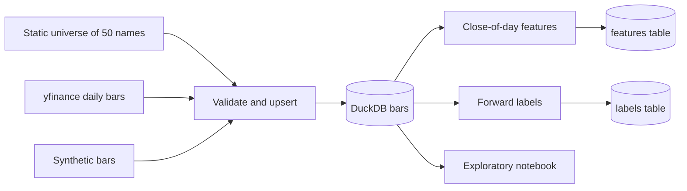

# Driftwood design decisions and interview guide

This is the document to study before talking about the project. It is written
alongside the code, milestone by milestone, and it describes what is actually
built. When a later milestone changes a decision, the old entry stays and a
new one says what replaced it.

## How to use this document

Read the architecture section out loud once. Then read each decision and
practice the interview answers without the document in front of you. The
answers are written in the first person so they can be said as-is, then
trimmed to the interviewer's patience.

## Architecture

Prices enter through one function, get checked, and land in a local database.
Features and labels are computed from that table and written back into the
same file, in two tables, so a query against `features` cannot see the
forward return.

A study is one DuckDB file. The default path is `data/driftwood.duckdb`
(`DRIFTWOOD_DB` overrides it). Rebuilding the file is always allowed; nothing
downstream is allowed to assume a hidden cache of unadjusted prices.

Commands that write the file:

- `driftwood ingest --start ... --end ...` calls yfinance.
- `driftwood ingest --synthetic` writes a deterministic random walk, with an
  optional 2-for-1 split, so the rest of the pipeline can be developed on a
  laptop with no network.
- `driftwood features` rebuilds the feature and label tables from whatever
  bars are already stored.

## Finance concepts in plain language

### OHLCV

A daily bar compresses a whole session into five numbers. Open is the first
print, high and low are the extremes, close is the last print, and volume is
how many shares changed hands. Driftwood does not store trades or quotes.
Anything we later say about "the price at 10:30" is a model built from this
bar, not a fact from the tape. That distinction matters as soon as execution
shows up.

### Adjusted close

Suppose a stock closes at $100 and splits 2-for-1 overnight. The next print
is about $50. A naive return of -50% is not a loss. The holder has twice as
many shares. Dividends do a smaller version of the same thing: the price
drops by roughly the dividend, and the holder is not poorer by that amount.

`adj_close` rewrites history so that percentage changes match the economic
return of a holder who reinvested dividends and rode through splits. Feature
math and model labels should use adjusted prices. The raw open, high, low,
and close stay in the table because they are what the exchange printed, and
because checking a suspicious return starts by comparing the two series.

The synthetic generator makes this concrete. One symbol is cut 2-for-1 at the
midpoint. Raw close and volume jump. `adj_close` does not. A test locks that
in: the raw return on the split day is worse than -40%, and the adjusted
return is an ordinary shock.

### Survivorship bias

If you take today's successful, liquid companies and download their history,
you have already selected winners. Companies that were delisted, acquired
under stress, or simply fell out of the large-cap list are missing. A
strategy tested only on survivors is graded on an easier exam than the one a
live book would have faced.

This project uses a fixed list of 50 names that are liquid right now. That is
a conscious shortcut for a portfolio project: the data is easy to explain,
the names are recognizable, and the downloads are reliable. It is not a
point-in-time S&P 500. Any performance number produced later has this bias
until a historical membership table is added. Say that before anyone asks.

### Lookahead bias

Lookahead bias is using information that was not available at the time of the
decision and then treating the result as if you could have traded it. The
classic version in this kind of project is a feature on Monday that quietly
includes Tuesday's close. The backtest looks brilliant. The live book cannot
see Tuesday.

Driftwood's rule is stamped at the **close** of session `t`. A feature on
that row may use the open, high, low, close, adjusted close, and volume of
session `t`, and any earlier session. It may not use session `t+1`. The same
day's high and low are allowed, because the decision is after the close, when
those prints have happened. They would not be allowed for a decision at the
open. That distinction is the whole argument, and it is written down as
`SIGNAL_TIME = "close"` next to the feature code.

The forward return is not a feature. `fwd_ret_1d` on day `t` is the adjusted
return from that close to the next stored close. It is the thing we would
like to predict. It lives in `labels.py` and in a separate database table.

Two operations that feel innocent and are not:

- A centered rolling mean. The value dated Monday uses days on both sides of
  Monday.
- A z-score, or any scaler, fit on the whole sample. The 2018 value then
  depends on the dispersion of 2024.

The check is truncation, and it is a test rather than a comment. Build the
features on the full panel. Build them again using only rows on or before a
cutoff. Every feature value on or before that cutoff has to match. The test
also runs the same check on a negative shift, a centered window, and a
full-sample z-score, and those three are required to fail. If someone
"simplifies" the test later, the negative cases still have to go red.

## Decision log

### ADR-001 — DuckDB as the research store

**Context.** The first cut is about 50 names, daily bars, and roughly 10
years: on the order of 100,000 rows. Later stages will join features and
predictions onto the same keys. The project has to install on Windows, Linux,
and macOS with no database server, and tests need a private database per run.

**Decision.** Store bars in one DuckDB file behind `MarketStore`. The bar
table has a primary key on `(symbol, date)`. A rerun is an
`INSERT ... ON CONFLICT DO UPDATE`, so a corrected download replaces the old
print instead of duplicating it. Coverage ("how many rows does AAPL have, and
what is the date range?") is a SQL query. Each ingest appends a row to
`ingest_runs` with a status and a JSON note of what was rejected.

**Alternatives.**

- Parquet or CSV only. Easy to inspect, awkward to upsert, and every coverage
  question becomes a pandas groupby. Parquet remains a reasonable export if a
  later stage wants a columnar snapshot outside the database.
- PostgreSQL. The right tool if several processes must write a shared
  production database. It is the wrong dependency for a single-researcher
  project and for CI.
- SQLite. Equally portable, and perfectly able to hold this table. Weaker
  once scans and window functions dominate, which is where this project is
  going. DuckDB returns a pandas frame in one call and is built for that scan.
- Keep the frame in memory and pickle it. There is then no durable record of
  what was downloaded, and the notebook cannot be reopened tomorrow.

**Tradeoff.** We take a dependency on DuckDB's SQL dialect, which is not
Postgres. Transactions and the `EXCLUDED` alias have to be tested rather than
assumed. In return there is no daemon, the file is gitignored, and a broken
download is fixed by deleting the file or by upserting over it.

**Why this one.** The data is an analytical table with a natural primary key,
used by one person. DuckDB matches that shape. The store API is small
(`upsert_bars`, `read_bars`, `coverage`, `read_runs`), so swapping the engine
later does not rewrite the research code.

### ADR-002 — Bar schema, and keeping both closes

**Context.** yfinance can return an auto-adjusted OHLC series and hide the
raw close, or it can return both. Downstream code will disagree about which
one it wants: return math wants the adjustment, a sanity check of a split
wants the raw print.

**Decision.** Every stored row has `symbol`, `date`, `open`, `high`, `low`,
`close`, `adj_close`, `volume`, `source`, and `ingested_at`. The downloader
calls yfinance with `auto_adjust=False` so `Adj Close` is a separate column.
If a future vendor frame omits that column, the normalizer copies `close`
into `adj_close` and warns, rather than inventing an adjustment factor. The
source string (`yfinance` or `synthetic`) and the ingest timestamp say where
a number came from.

The universe used for a run is written to `universe_members` (symbol, name,
sector). An unknown ticker is stored as sector `Unknown` instead of being
dropped, so an ad-hoc download is still described by the database.

**Alternatives.**

- Store only adjusted OHLC. Simpler joins later, but a bad adjustment becomes
  invisible.
- Store a corporate-action event table and adjust ourselves. More correct, and
  more than this milestone should own. yfinance's adjusted close is the event
  table, compressed into one column, with the vendor's known quirks.
- Store one row per field (long format). Flexible and painful to read.

**Tradeoff.** Two close columns means every later query must choose. The
column names are explicit so the choice is visible. We do not yet build
adjusted open, high, and low; a later execution stage will scale the raw
OHLC by `adj_close / close` when it needs a split-safe path.

**Why this one.** Disk is cheap next to the cost of being unable to explain a
return. The primary key makes "one session, one print" a constraint rather
than a convention.

### ADR-003 — A fixed list of 50 liquid names

**Context.** The brief asks for about 50 liquid S&P 500 stocks and about 10
years of daily bars. A point-in-time membership history is a data product of
its own (and many of the good ones are paid).

**Decision.** `driftwood/data/universe.py` holds 50 current large, liquid US
listings spread across sectors, with a display name and a GICS-style sector.
The sector is metadata for the notebook and for a later neutral portfolio. It
is not a model feature yet. The CLI defaults to this list and accepts
`--symbols` for a smaller pull.

**Alternatives.**

- The actual S&P 500 point-in-time. Right answer for a live research process,
  wrong first dependency.
- A handful of names such as SPY constituents' top 10. Faster, but too small
  to show a cross-sectional signal later.
- Pull whatever yfinance returns for `^GSPC` today and pretend it is history.
  That is survivorship bias with extra steps, and the index's current members
  are not all equally liquid.

**Tradeoff.** Interviews will ask about survivorship, and the honest answer
is "yes, the study has it." We would rather give that answer than hide the
list behind a download that looks more official than it is.

**Why this one.** The list is readable in one file, stable in tests, and
liquid enough that a later paper-trading stage is not fighting penny-stock
prints. `BRK-B` is left out on purpose: the hyphen is a needless source of
vendor-symbol bugs in a first version.

### ADR-004 — One network function, everything else pure

**Context.** Tests must not need a network or an API key. yfinance's frame
shape has changed across versions (flat columns for one ticker, a column
`MultiIndex` in either field-then-ticker or ticker-then-field order, and
sometimes no `Adj Close` when prices are pre-adjusted).

**Decision.** `fetch_yfinance_bars` is the only function that imports
yfinance. It forces `auto_adjust=False`, `group_by="column"`, `threads=False`,
and `progress=False`. `normalize_download` turns those layouts into one
long frame: `symbol, date, open, high, low, close, adj_close, volume`.
`ingest_frame` validates and writes. Tests replace `fetch_yfinance_bars` or
call `normalize_download` on a hand-built frame. A rectangular download pads
missing sessions with all-NaN prices; those padding rows are dropped before
validation so they are not reported as corrupt prints.

**Alternatives.**

- Mock HTTP. Brittle, because yfinance's URLs and cookies move, and it tests
  their client more than our code.
- Record a fixture of a real download and check it in. Honest, but large, and
  it goes stale the next time the column layout changes. The normalizer tests
  cover the layouts directly with a few rows.
- Call the network in CI and skip on failure. That is a flaky test with a
  permission slip.

**Tradeoff.** A bug inside yfinance itself will not be caught here. A bug in
how we ask yfinance for data will: the test asserts `auto_adjust is False`
and the date arguments. That is the bug that would silently change every
return in the project.

**Why this one.** The risky part of ingestion is the reshape and the decision
to adjust or not. Those are pure functions and they are where the tests sit.

### ADR-005 — Reject bad bars before they are stored

**Context.** A single inverted high/low or a zero price becomes an absurd
return and then a confident model coefficient. Downstream code should not
have to re-check the vendor.

**Decision.** `validate_bars` drops a row for the first reason that applies:
missing symbol or date, non-finite price, non-positive price, high/low that
cannot contain the open and close, or a volume that is missing, negative, or
not a whole share count. Duplicate `(symbol, date)` keys in one batch keep
the last row and count the others as `duplicate_in_batch`. The ingest result
and the `ingest_runs.notes` JSON both carry the counts. A run that writes
nothing is status `empty` and the CLI exits 1. A crash during the write is
status `error`, and the exception still propagates.

Symbols are passed to DuckDB as bound parameters. A ticker is never
interpolated into the SQL string.

**Alternatives.**

- Coerce and keep going (replace bad highs with the close, fill volume with
  zero). That hides data bugs inside the research.
- Fail the whole batch on the first bad row. Safer, but one bad name should
  not discard a 50-name download. Missing symbols are listed instead.

**Tradeoff.** Strict volume rules can reject a vendor row that used a
fractional share count. These names trade in whole shares at the daily-bar
level we care about, and a fractional volume is much more likely to be a
parse error. The threshold for "this float is an integer" is `1e-6`, so
`1000.0` is accepted.

**Why this one.** Garbage rows are cheap to drop and expensive to debug six
milestones later. The counts make the drop visible.

### ADR-006 — A synthetic book with a known split

**Context.** The notebook, the CLI, and every later test need bars when
yfinance is unreachable. The series also needs one feature a reviewer can
check by eye.

**Decision.** `synthetic_bars` draws a seeded geometric random walk on
business days, builds a high and low around the open and close, and, when
asked, applies a 2-for-1 split to one symbol at the midpoint. The raw OHLC
halves, volume doubles, and `adj_close` stays on the pre-split path. The same
seed returns the same frame. The default CLI path does not split; the
notebook and the `--split-symbol` flag opt in.

**Alternatives.**

- Check a small real CSV into the repo. Reproducible, but then the project
  ships market data and a license question, and the split is whatever the
  vendor did.
- Use random data with no split. Fine for smoke tests, useless for teaching
  adjustment.

**Tradeoff.** Nobody should quote a Sharpe ratio from this data. The
generator is named `synthetic` and the stored `source` column says so.
Random-walk prices have none of the cross-sectional structure a later model
will try to find; tests that need a known signal will construct that signal
on top, not expect the walk to contain it.

**Why this one.** It makes the adjusted-close story demonstrable in the
notebook and lockable in a test, with no network.

### ADR-007 — Features are known at the close, and labels are a different function

**Context.** Every later number in the project is a claim about what was
knowable at a timestamp. The dangerous mistake is not a subtle off-by-one in
a model. It is a feature column that agrees with the future because it
contains the future.

**Decision.** `build_features` is the only function a model is allowed to
treat as an input, and it is causal at the close. `build_labels` is the only
function allowed to call `shift(-...)`. They are merged in
`build_research_frame` on `(symbol, date)` with a one-to-one check, and they
are stored in two DuckDB tables. `MODEL_FEATURES` is the z-scored columns.
`LABEL_COLUMNS` is `fwd_ret_1d` and `fwd_ret_5d`. Training code, when it
arrives, has to name one of those lists. It does not get to do `select
numeric columns`.

`assert_causal_features` implements the truncation test. The feature modules
that claim to be causal are also scanned for `.shift(-` and `center=True`.
The label module is scanned for the opposite, so the source test cannot be
satisfied by deleting the labels.

**Alternatives.**

- Compute everything in one function and ask reviewers to be careful. That
  lasts until the first late-night edit.
- Shift every feature by one day "to be safe," which throws away the close
  and still does not catch a centered window or a full-sample scaler.
- Only test that the label column is not in the feature list. That catches
  the obvious leak and misses the window that reaches past the cutoff.

**Tradeoff.** The close-of-day rule means a feature may use today's high.
That is correct for a decision made after the close and wrong for a decision
made at the open. Encoding the timestamp in a constant forces the
conversation instead of hiding it. The truncation test costs a few extra
feature builds in CI. That is cheap next to a leaked backtest.

**Why this one.** The failure mode is silent and flattering. The test has to
be able to fail, including on purpose, or it is documentation.

### ADR-008 — Which features, and why these

**Context.** The first model needs a small set of inputs an interviewer can
explain, built only from daily bars. This is not a search for the best
alpha.

**Decision.** Ten raw features, all simple returns or ratios of adjusted
close except where noted:

- `ret_1d`, `rev_5`, `mom_21`, `mom_63`: trailing simple returns over 1, 5,
  21, and 63 sessions.
- `mom_12_1`: close from 21 sessions ago over close from 252 sessions ago,
  minus one. This is the classic 12-minus-1 momentum: the year of return
  ending one month ago. The skipped month is where short-term reversal
  usually shows up, so it is its own feature (`rev_5`) rather than being
  mixed into the year.
- `vol_21`: standard deviation of `ret_1d` over 21 sessions, sample divisor
  (`ddof=1`), minimum 15 observations. Not annualized. A model coefficient
  can rescale it.
- `volume_shock`: volume divided by its own 21-session trailing mean.
- `dist_sma_21`: adjusted close over its 21-session mean, minus one.
- `hl_range`: `(high - low) / close`, using the raw prints because they share
  a scale. Dividing a raw range by the adjusted close blows up on a split.
- `log_volume`: log of share volume. Not dollar volume. Dollar volume needs a
  price and a volume that agree about splits, and the raw close and the
  vendor volume do not always agree. See the limitations.

Returns are simple, not log. A later portfolio sums simple returns across
names. Log returns would be a better input to a volatility estimate and a
worse match to the backtest's accounting. Volatility uses the simple returns
anyway, with the sample standard deviation, and the choice is local to that
column.

`ret_1d` is the change since the previous stored session for that symbol. On
a complete business-day panel that is one session. A hole in the panel makes
it a multi-day return. We do not forward-fill prices to hide the hole.

**Alternatives.**

- A large technical-indicator library. More columns, more chances to leak,
  and nothing to say in an interview except "the library did it."
- Log returns throughout. Cleaner for compounding, less obvious when the
  label is a holding-period return.
- Dollar volume as a liquidity feature. Right idea, wrong until the split
  factor is stored explicitly.

**Tradeoff.** Ten features will not span the cross-section of a real
multi-factor model. They are enough to see whether a linear model has any
rank correlation with the next day's return, which is the next milestone.
Long-window features are missing for the first year of a name. Those rows
stay in the table as missing. They are not filled with zero, because zero is
a real value (a flat return, a z-score at the mean).

**Why this one.** Each column has a one-sentence definition and a hand-checked
formula in the tests. That is the bar for adding the next column too.

### ADR-009 — Cross-sectional z-scores, fit inside the day

**Context.** The raw features are in different units. A ridge regression on
`log_volume` next to `ret_1d` mostly fits the volume. The usual fix is to
standardize. The usual leak is to fit that standardization on the sample you
are about to pretend you did not see.

**Decision.** For each raw feature and each date, clip the cross-section at
the 5th and 95th percentiles, then subtract the mean and divide by the
population standard deviation (`ddof=0`). The result is `z_<feature>`. The
raw column is kept, unclipped, so a clipped name can be inspected. A day
with no dispersion becomes 0 for names that had a value. Missing inputs stay
missing. `MODEL_FEATURES` points at the z-scores only.

The population divisor is deliberate and different from `vol_21`. Realized
volatility is a sample estimate, so it uses `ddof=1`. The z-score is a
rescaling of one day's names, and `ddof=0` is the rescaling that does not
depend on a Bessel correction. With 50 names the two are almost the same.
The reason to pick one and write it down is so the choice is not an accident
of a library default.

**Alternatives.**

- `StandardScaler` fit on the training window inside each walk-forward fold.
  Also causal, if the fit truly stops at the training cutoff, and a
  reasonable thing to add inside the model rather than inside the feature.
  It standardizes across time and names together, which is a different
  object from "how unusual is this name today."
- Rank transform to `[-0.5, 0.5]`. More robust to outliers, less connected
  to a linear coefficient's units. Worth trying later. Winsorizing first is
  the smaller step.
- No scaling, and let the model regularize. Ridge can survive it. The
  coefficient on volume is then not comparable to the coefficient on
  momentum, which makes the model harder to talk about.

**Tradeoff.** A z-score inside a 50-name universe is not a z-score against
the market. A name can look extreme because the other 49 were quiet. The
5/95 clip with 50 names moves only the tails. It will not save a bad data
point that is merely large rather than absurd, and it is not a substitute
for the bar validator.

**Why this one.** It is causal by construction, it puts the features on one
scale, and the truncation test covers the z-score columns, not just the raw
ones. A full-sample scaler is one of the cases the test is required to
reject.

## Known limitations

- Survivorship bias, as above. No delistings, no historical index membership.
- Daily bars only. Nothing in the file can tell you the intraday path.
- Adjusted close is the vendor's number, not an event-level replay we control.
  yfinance has had adjustment bugs in the past. The raw close is the check.
- The synthetic split scales the whole post-split OHLC. It does not model an
  opening auction or a dividend.
- One writer, one file. There is no locking story for two ingests at once.
- `universe_members` is replaced on each ingest with the symbols requested
  that time. It is "who this file was last loaded for," not a history of
  membership.
- `ret_1d` crosses a gap when a symbol is missing a session. It is not
  forward-filled back into a one-calendar-day return.
- `volume_shock` and `log_volume` use vendor volume as stored. yfinance
  volume is usually already split-adjusted, while our synthetic split doubles
  raw volume, so the synthetic book shows a volume spike the vendor series
  usually will not. Dollar volume is not a feature until a split factor is
  stored on purpose.
- The z-score is against this 50-name universe on that day, not against the
  market. It is not sector-neutral.
- Same-day high and low are inputs. The features are invalid for an
  open-of-day decision without removing them.
- `mom_12_1` is missing for roughly the first year of each name. Those cells
  stay missing.
- No model, simulator, backtest, broker, or dashboard exists yet.

## What I would build next on this stage

A point-in-time membership table. A stored split factor (`adj_close / close`,
or a cleaner split-only factor) so dollar volume and adjusted high/low are
unambiguous. Sector-neutral z-scores, by demeaning inside sector before the
full-universe z-score. None of that blocks a baseline model, as long as the
survivorship limitation and the close-of-day clock stay written down.

## Interview questions

### Walk me through the project

Two-minute version of what exists today. Later milestones extend this answer;
they do not get claimed yet.

"Driftwood is a US equity research pipeline I'm building from daily prices
through paper trading. What exists so far is the data and the features, and
the features are not allowed to see the future.

The universe is 50 liquid large caps, a current snapshot, so it has
survivorship bias and I say that before quoting any result. I download daily
bars with yfinance, auto-adjust off, and I store the raw close next to the
adjusted close. Returns use the adjusted series, so a split is not a crash.
The raw close is how I check the vendor. Tests use a synthetic book with a
known 2-for-1 split and never call the network.

Bars are validated and upserted into a local DuckDB file on symbol and date.
I picked DuckDB over Postgres because this is one researcher and one file,
and over CSV because I want a primary key.

A feature is stamped at the close. On day t it may use that day's bar and
earlier bars, not tomorrow's. The set is small on purpose: trailing returns,
12-minus-1 momentum, 21-day volatility, a volume shock, distance from a
trailing average, the day's high-low range, and log volume. I winsorize and
z-score each one across the names on that same day. I do not fit a scaler on
the whole sample, because then 2018 would know about 2024. The next-day and
five-day returns are labels. They live in a separate function and a separate
table, so a select from the feature table cannot see the answer.

The test I would walk through truncates history at a cutoff and rebuilds the
features. They have to match. A centered moving average fails that test, and
so does a z-score fit on the full sample. Those failures are in the suite, so
the check is not a comment."

### Why DuckDB instead of Parquet or Postgres?

"Parquet is a file format. I would still need to invent upserts, a run log,
and the coverage query. Postgres is what I would want if more than one
process had to share a production database. Here the whole dataset is about a
hundred thousand daily rows and one user, so an embedded analytical database
is the smaller system. DuckDB gives me SQL, a primary key, and a dataframe
back. The application code talks to a small store class, so the choice is not
smeared across the project."

### Why store the raw close and the adjusted close?

"They answer different questions. The adjusted close is the economic series:
a 2-for-1 split should not look like the stock fell in half. The raw close is
the print, and it is how I notice a bad adjustment. I force yfinance's
auto-adjust flag off so the vendor cannot collapse those into one column
without me seeing it. If the adjusted column is ever missing, I copy the raw
close and warn, rather than guessing a factor."

### Does this backtest have survivorship bias?

"The data stage already does, and I have not backtested yet. The universe is
50 names that are large and liquid now. Anything that was delisted or fell
out of the large-cap set over the last ten years is absent. I would not quote
a performance number from this list as if it were a tradable historical
S&P 500. The fix is a membership table with as-of dates, and I have not built
that."

### How do you test a downloader without hitting the network?

"The download is one function. Everything after it is a reshape, a validator,
and a database write. Tests call the reshape with the column layouts yfinance
has actually returned, and they replace the download function when they want
to exercise the CLI. One test checks the arguments we would have sent,
including auto-adjust off. I do not mock the HTTP layer, because that tests
yfinance's client rather than my invariant."

### What happens if ingestion runs twice?

"The bar primary key is symbol plus date. The second run updates those rows
in place, including the source and the ingest timestamp. The run log is
append-only, so I can see that a correction happened. Symbols that were
requested and produced no valid row are listed on the result; they are not
silently filled."

### What is lookahead bias, and how do you prevent it here?

"It means a feature dated Monday that used Tuesday's close, and a backtest
that then treats Monday's trade as if that had been legal. My clock is the
close. Today's open, high, low, close, adjusted close, and volume are known.
Tomorrow is not. Labels, which are the forward returns, are computed in a
different function and stored in a different table.

I don't rely on reading the code. The test cuts the panel off at a date,
rebuilds the features, and requires every value on or before that date to
match, including the z-scores. A centered rolling mean and a scaler fit on
the full sample both fail that test, and the suite asserts that they fail.
Using today's high is not lookahead under a close-of-day clock. It would be
lookahead if I claimed the signal was available at the open."

### Why z-score inside the day instead of scaling the whole training set?

"Those are different objects. A within-day z-score says how unusual a name
is relative to the other names I hold that day, which is what a cross-sectional
long-short book trades on. A scaler fit on the training window says how
unusual a value is relative to history. The second one is fine inside a
walk-forward fold if the fit stops before the test dates. It is not fine fit
on the whole file. I winsorize at 5 and 95 percent first so one bad print
does not set the scale, and I use the population standard deviation because
this is a rescaling, not a volatility estimate. The realized-vol feature uses
the sample divisor on purpose. They are different jobs."
